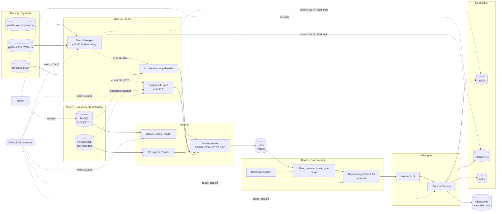
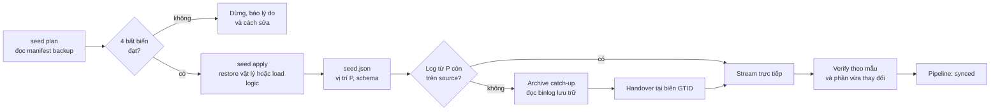
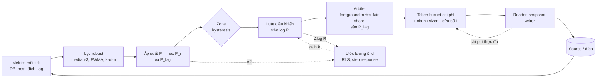
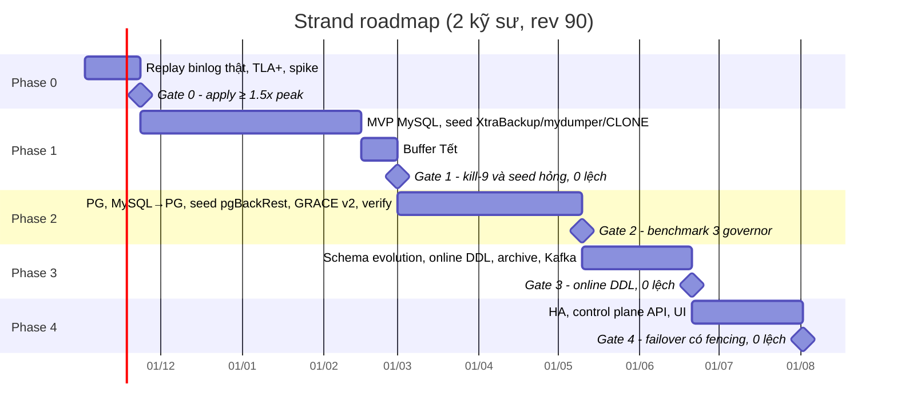

# Strand CDC — Kiến trúc Tổng thể & Kế hoạch Triển khai

Oct 31, 2026 · @hieuny

## Tóm tắt điều hành

**Strand** là CDC engine dạng single binary viết bằng Go. Nó đọc MySQL binlog (GTID) và PostgreSQL logical replication (pgoutput) rồi ghi sang MySQL, PostgreSQL hoặc Kafka, với mục tiêu **effectively-once** mà không cần Kafka hay Flink cluster. Strand khả thi với DB hàng TB dưới giới hạn IOPS, với điều kiện dữ liệu ban đầu của bảng lớn được nạp từ backup thay vì snapshot logic (mục 7).

**Ba chế độ khởi tạo dữ liệu**, người dùng chọn cho từng pipeline hoặc từng bảng (mục 2):

1. **Snapshot logic** (mặc định): đọc theo chunk, có GRACE throttle. Hợp với bảng nhỏ và vừa.
2. **Seed từ file backup** (tùy chọn, không bắt buộc): dùng XtraBackup, mydumper, pgBackRest… có sẵn. Source tốn 0 IOPS cho việc seed. Phù hợp với bảng hàng TB.
3. **Start-at thủ công:** dữ liệu ở đích đã có sẵn, Strand chỉ stream từ một GTID hoặc LSN được chỉ định.

**Bốn điểm khác biệt so với Debezium và Flink CDC:**

- **GRACE v2:** tự điều tiết tốc độ dựa trên sức khỏe thực của DB, có biên ổn định giải tích (mục 5).
- **Apply song song theo writeset:** vẫn giữ nguyên ranh giới transaction (mục 6).
- **Checkpoint trong cùng transaction với dữ liệu ở đích:** restart không bị trùng, không bị mất.
- **Verifier tích hợp:** kiểm chứng dữ liệu ở cả hai phía.

**Nguyên tắc thiết kế**, theo thứ tự ưu tiên: đúng đắn > ổn định của DB nguồn > độ trễ > throughput. Các nguyên tắc cụ thể:

- Không ghi gì vào DB nguồn.
- Đọc từ replica hoặc standby nếu có.
- Mọi thao tác ghi ở đích đều idempotent.
- Strand không tự làm công cụ backup; nó chỉ đọc, kiểm tra và điều phối các tool backup native.

**Phạm vi.** Strand **không thay replication native cho DR cùng loại DB** (MySQL→MySQL, PG→PG); trường hợp đó vẫn nên dùng replication native. Giá trị của Strand nằm ở pipeline có lọc hoặc biến đổi dữ liệu, đồng bộ giữa hai loại DB khác nhau, và throttle thông minh khi IOPS bị giới hạn. Phase 1 nhắm vào đúng môi trường hiện tại, không phải một tool tổng quát để cạnh tranh với Debezium.

## 1. Tổng quan kiến trúc

Pipeline có năm tầng, nối với nhau bằng **hàng đợi có giới hạn** (bounded queue) và một **spool** trên đĩa. GRACE Governor đứng ngoài đường dữ liệu: nó đọc tín hiệu sức khỏe và điều chỉnh token cùng số worker cho từng tầng.



### Thành phần

| Thành phần | Trách nhiệm | Điểm thiết kế then chốt |
| --- | --- | --- |
| MySQL Binlog Reader | `COM_BINLOG_DUMP_GTID`, parse row event | Bắt buộc `binlog_format=ROW` và `binlog_row_image=FULL`. Đọc từ replica có `log_replica_updates=ON` |
| PG Logical Reader | `START_REPLICATION` với pgoutput proto v4 | Ưu tiên decode trên standby (PG16+). Bật streaming và two\_phase. Vẫn gửi standby status khi đang backpressure |
| Snapshot Engine (chế độ A) | Đọc dữ liệu ban đầu theo chunk | MySQL: watermark bằng GTID; event của range đang đọc được gộp theo PK rồi merge có thứ tự. PG: dùng snapshot export từ slot (mục 6.1) |
| Seed Manager (chế độ B) | Đọc manifest của backup, kiểm tra, điều phối restore hoặc load | Gọi tool native (xtrabackup, myloader, pgbackrest), không tự viết lại logic restore. Ghi `seed.json` (mục 3) |
| Archive Catch-up Reader | Đọc file binlog lưu trữ từ S3 hoặc đĩa | Dùng khi binlog trên source đã bị purge sau thời điểm backup. Chuyển sang stream trực tiếp tại biên GTID |
| Txn Assembler | Gom row event thành transaction | XA và 2PC chỉ được phát ra khi COMMIT. Transaction lớn tràn xuống spool |
| Spool | Log cục bộ dạng segment, nén zstd | Tách tốc độ reader khỏi writer; có ngân sách RAM và đĩa cứng |
| Schema Registry | Schema theo vị trí trong log | Khi seed từ backup, schema ban đầu lấy từ chính backup. DDL là barrier |
| Dependency Scheduler | Chia transaction cho worker | Writeset gồm PK, unique key và FK cha (mục 6.2) |
| Commit Orderer | Commit theo thứ tự, ghi checkpoint | Checkpoint nằm trong cùng transaction với dữ liệu |
| GRACE v2 Governor | Điều tiết tài nguyên cho mỗi source identity | Bao gồm cả IOPS của đích khi load seed logic (mục 5) |
| Verifier | So sánh source với đích | Kiểm tra theo mẫu sau seed; kiểm tra phần vừa thay đổi; verify toàn bộ theo vòng với cây Merkle |

### Mô hình nhất quán

**Định danh transaction.** Mỗi transaction được định danh bằng chính vị trí của nó trong log nguồn: **GTID** với MySQL (kể cả tagged GTID của 8.4), **commit LSN** với PostgreSQL. Đây là khóa dedup duy nhất được lưu lại. Scheduler có dùng một số thứ tự nội bộ để sắp việc, nhưng số đó chỉ nằm trong bộ nhớ, không bao giờ được ghi xuống. Nhờ vậy, đổi bộ lọc bảng hay đổi replica đang đọc giữa hai lần chạy vẫn resume đúng.

**Effectively-once cho đích là DB: checkpoint hai tầng.** Mỗi worker chỉ biết những gì chính nó đã apply, và transaction của các worker xen kẽ nhau. Nếu mỗi worker tự lưu tập đã apply của riêng nó thì tập đó không gộp thành khoảng được. Khi có một transaction dài giữ mốc chung lại, row của mỗi worker sẽ phình theo throughput. Vì vậy checkpoint được chia làm hai tầng:

| Tầng | Ai ghi, khi nào | Nội dung | Kích thước |
| --- | --- | --- | --- |
| Row toàn cục `_strand_checkpoint` | Coordinator, mỗi 100–500 ms, trong một transaction riêng | `lwd` (mọi transaction tới đây đã apply), `high` (mốc cao nhất đã gộp), `holes` (các transaction **chưa** apply trong khoảng lwd đến high) | Bị chặn bởi số transaction đang chạy. Một transaction dài chỉ là **một lỗ** |
| Row delta `_strand_worker_delta` | Worker, **trong cùng transaction** với dữ liệu của batch | Những transaction worker đã apply **sau** `high` của row toàn cục | Bị chặn bởi chu kỳ compaction nhân tốc độ của worker, không phụ thuộc thời gian chạy của transaction dài |

**Mỗi chu kỳ compaction:**

1. Coordinator đọc toàn bộ row delta.
2. Gộp chúng vào tập toàn cục, ghi row toàn cục mới.
3. Ở batch kế tiếp, mỗi worker cắt bỏ phần ≤ `high` mới khỏi row delta của mình.

Nếu crash xảy ra giữa các bước thì chỉ sinh ra phần chồng lấn giữa hai tầng, không bao giờ thiếu.

- **MySQL:** mọi tập được biểu diễn thành GTID set, nên ở tầng toàn cục chúng tự gộp, ví dụ `uuid:1-999:1001-50000`.
- **PostgreSQL:** lưu commit LSN. Cả hai bảng được tạo với `fillfactor=50` để UPDATE là HOT update.
- **Chặn cứng (lớp bảo vệ cuối):** nếu số lỗ toàn cục vượt N (mặc định 4.096) thì scheduler ngừng nhận transaction mới. Transaction dài không chạm ngưỡng này, vì nó chỉ là một lỗ.
- **Chế độ `strict`:** commit đã tuần tự nên không có lỗ và không cần row delta. Checkpoint chỉ là một vị trí, được ghi trong transaction commit cuối của mỗi batch.

**Rào chắn cho row delta.** Compaction chỉ là gộp tập khoảng trong bộ nhớ rồi ghi một row, nên nhanh hơn worker nhiều bậc. Rủi ro thật là coordinator bị treo. Vì vậy:

- Row delta của mỗi worker có trần (mặc định 64 KB).
- Vượt trần thì worker tự kích hoạt compaction đồng bộ. Nếu vẫn không được, worker ngừng nhận việc.
- Metric `strand_checkpoint_compaction_lag_seconds`, kèm alert khi vượt 5 giây.

Khi khởi động lại:

1. **Tập đã apply** = tập trong row toàn cục (mọi transaction ≤ lwd, cộng khoảng lwd đến high trừ các lỗ) ∪ mọi row delta.
2. **Reader resume:**
   - MySQL gửi `COM_BINLOG_DUMP_GTID` với chính tập đã apply. Server tự gửi lại đúng những transaction còn thiếu, kể cả các lỗ.
   - PostgreSQL chạy `START_REPLICATION` từ lwd.
3. **Scheduler** bỏ qua mọi transaction đã nằm trong tập đã apply.

Thiết kế này không phát sinh lệnh DELETE nào ở đích và không có bảng nào phình to theo thời gian.

**Chỉ một writer cho mỗi pipeline (rev 90).** Khi khởi động, Strand lấy khóa `strand:<pipeline_id>` trên đích (`GET_LOCK` / `pg_try_advisory_lock`), rồi tăng cột `epoch` trong `_strand_pipeline` và gán epoch mới vào row toàn cục cùng mọi row delta. Mọi transaction ghi row delta hoặc row toàn cục đều có điều kiện `epoch = <epoch của mình>`; ảnh hưởng 0 row thì rollback và dừng với mã `fenced`. Khóa chặn instance thứ hai lúc khởi động; `epoch` chặn writer cũ còn chạy dở, kể cả khi pod bị phân vùng mạng. Đến Phase 4, lease etcd thay cho khóa, còn fencing vẫn dùng cột này.

**Kafka.** Dùng idempotent producer cộng Kafka transaction; offset nguồn ghi vào topic nội bộ trong cùng transaction. Nếu tắt transaction: at-least-once, header mang `strand.seq` để consumer tự dedup.

**Out-of-order.** Một source log tự nó có thứ tự toàn phần. Lệch thứ tự chỉ sinh ra ở ba chỗ, và mỗi chỗ có cách xử lý riêng:

- Snapshot chạy song song với stream: xử lý bằng watermark và backfill.
- Apply song song: xử lý bằng writeset và commit orderer.
- Nhiều nguồn ghi cùng một đích: mỗi row ở đích mang `(source_id, seq)`, chỉ apply khi version mới lớn hơn version đang có.

**Giao dịch phân tán.** XA của MySQL và 2PC của PostgreSQL chỉ được phát ra khi COMMIT PREPARED; ROLLBACK PREPARED thì hủy buffer. Transaction xuyên nhiều DB ở tầng ứng dụng không có đồng hồ chung nên không thể khôi phục chính xác. Phase 3 hỗ trợ **consistency group**: các pipeline trong nhóm chỉ công bố checkpoint khi tất cả đã vượt qua cùng một mốc heartbeat timestamp.

**Schema evolution.** DDL của MySQL được parse và cập nhật Schema Registry tại đúng vị trí của nó trong log. Với PostgreSQL, Strand so sánh message `Relation` của pgoutput với schema cũ để phát hiện thay đổi, vì DDL không đi qua logical replication. Chính sách:

- Thay đổi kiểu cộng thêm (add column, nới rộng kiểu) được tự apply.
- Thay đổi phá hủy (drop, đổi kiểu thu hẹp, đổi PK) làm pipeline **dừng lại**, chờ chạy `strand schema approve`.

## 2. Ba chế độ khởi tạo dữ liệu

Mọi pipeline cần hai thứ: dữ liệu ban đầu ở đích, và một vị trí log khớp **chính xác** với dữ liệu đó. Strand có ba cách để có cả hai.

- **Mặc định là chế độ A**, có thể chạy ngay mà không cần chuẩn bị gì.
- **Chế độ B (seed từ backup) hoàn toàn là tùy chọn.** Thiếu file backup thì Strand vẫn chạy bình thường.
- Ba chế độ có thể **trộn theo từng bảng** trong cùng một pipeline.

|  | A. Snapshot logic | B. Seed từ backup | C. Start-at thủ công |
| --- | --- | --- | --- |
| Cách làm | Đọc theo chunk trên source, kèm watermark | Restore vật lý hoặc load file logic có sẵn, rồi stream từ vị trí ghi trong backup | Đích đã có dữ liệu, Strand stream từ `--start-at <gtid\|lsn>` |
| IOPS tốn ở source | Toàn bộ dung lượng bảng, có GRACE throttle | 0 nếu dùng backup sẵn có; chỉ đọc log | 0 |
| Phù hợp | Bảng dưới khoảng 50–100 GB, bảng mới thêm, backfill lại | Bảng hàng TB, lần khởi tạo đầu tiên, DR site mới | Đích được dựng bằng cách khác (clone volume, replica cũ) |
| Chuyển sang DB khác loại, mask, rename | Có | Chỉ với backup logic | Không liên quan |
| Rủi ro chính | Lâu; phải giữ binlog/WAL suốt thời gian snapshot | Sai vị trí; log không phủ đủ từ backup đến hiện tại | Người dùng nhập sai vị trí, nên Strand bắt buộc chạy verify sau đó |
| Kiểm tra Strand tự làm | Watermark và backfill | `seed plan`: checksum, vị trí, độ phủ của log, version | `gtid_purged` / `restart_lsn`, verify theo mẫu |

**Quy tắc chọn nhanh:**

1. Bảng lớn hơn khoảng 100 GB, hoặc thời gian snapshot ước tính (`strand plan`) vượt quá thời gian giữ binlog/WAL chia 2: chọn **B**.
2. Không có backup phù hợp, hoặc cần mask/đổi loại DB mà chỉ có backup vật lý: chọn **A**, chạy theo lịch ngoài giờ cao điểm.
3. Đích đã được dựng sẵn và biết chắc vị trí: chọn **C**.

Ví dụ trộn chế độ trong một pipeline: bảng `orders` (3 TB) seed từ mydumper, các bảng còn lại snapshot logic. Strand đảm bảo tính nhất quán giữa hai nhóm bằng cách:

- Stream từ **vị trí nhỏ nhất** (vị trí của backup).
- Với các bảng snapshot logic, áp dụng quy tắc trạng thái theo range PK ở mục 6.1.

## 3. Seed từ file backup (tùy chọn)

Chế độ B có hai lợi ích lớn:

- Seed bảng hàng TB mà **source không tốn IOPS** nào.
- Biến bài toán khó nhất của CDC với DB lớn thành một việc vận hành đã quen thuộc: restore backup.

Strand không tự tạo backup cũng không tự restore. Nó đọc manifest, kiểm tra, gọi tool native, rồi stream tiếp đúng từ vị trí của backup. Bỏ qua chế độ này thì mọi phần khác của Strand vẫn hoạt động bình thường.

### 3.1 Bốn bất biến bắt buộc

Một lần seed chỉ được chấp nhận khi `strand seed plan` chứng minh được cả bốn điều sau. Thiếu một điều là Strand từ chối chạy.

1. **Nhất quán tại đúng một vị trí P.** Backup phải phản ánh đúng trạng thái sau transaction cuối cùng thuộc P (GTID set hoặc LSN), không hơn không kém. Strand **tự đọc P từ metadata** của backup, không nhận P do người dùng gõ tay. Ngoại lệ duy nhất là chế độ C.
2. **Log liền mạch từ P đến hiện tại.** Mọi transaction sau P phải còn đọc được, từ binlog/WAL trên source hoặc từ kho lưu trữ binlog/WAL.
3. **Biết schema tại P.** Schema được lấy từ chính backup, làm điểm khởi đầu cho Schema Registry.
4. **Đích tương thích.** Backup vật lý cần cùng engine, cùng dòng version (major, và với MySQL là cả dòng 8.0, 8.4 hay 9.x), cùng kiến trúc CPU. Backup logic thì chỉ cần map được kiểu dữ liệu.

**Quy tắc retention.** Thời gian giữ binlog/WAL (trên source hoặc trong kho lưu trữ) phải ≥ 1.5 × (tuổi của backup + thời gian restore). Cách an toàn nhất là **lưu trữ binlog/WAL liên tục** lên object storage. Khi đó seed không phụ thuộc vào `binlog_expire_logs_seconds` hay `max_slot_wal_keep_size` của source.

### 3.2 Nên dùng backup nào

| Tình huống | Nên dùng | Vì sao |
| --- | --- | --- |
| MySQL→MySQL, cùng dòng version, bảng hàng TB | **XtraBackup** lấy từ replica (hoặc bản backup định kỳ sẵn có) | Nhanh nhất, copy tuần tự, không phải dựng lại index |
| MySQL→MySQL khác version, chỉ cần một số bảng, hoặc cần mask | **mydumper / myloader** | Backup logic, chọn được từng bảng, có GTID trong metadata |
| MySQL→PostgreSQL | **mydumper**, sau đó Strand loader (`COPY`) | Chỉ backup logic mới chuyển được sang loại DB khác |
| MySQL, có storage snapshot (Ceph, VMware, LVM) | **Snapshot volume** của replica | Gần như tức thì; vị trí lấy từ `gtid_executed` của chính instance đã restore |
| PG→PG cùng major | **pgBackRest** (hoặc WAL-G) kèm PITR đến đúng LSN của slot | Chính xác theo LSN, không giữ xmin trên source |
| PG→PG khác major, chỉ một số bảng, PG→MySQL, hoặc cần mask | **`strand export`** (chạy `pg_dump --snapshot` gắn với slot) | `pg_dump` cũ không gắn slot thì không có vị trí chính xác |
| Không có backup phù hợp | Chế độ A, hoặc tạo backup mới từ replica/standby có throttle |  |

**Ưu tiên dùng bản backup định kỳ sẵn có** vì nó không tạo thêm tải nào. Nếu phải tạo backup mới riêng cho việc seed, hãy luôn chạy trên **replica/standby**, không bao giờ chạy trên primary.

### 3.3 MySQL: dùng gì và dùng thế nào

#### XtraBackup (vật lý), lựa chọn số 1 cho bảng hàng TB

**Chọn đúng phiên bản theo dòng MySQL:**

- MySQL 8.4 dùng XtraBackup 8.4 (bản mới nhất là [8.4.0-6, phát hành 24/06/2026](https://docs.percona.com/percona-xtrabackup/8.4/print_page.html)). Bản 8.4 không hỗ trợ backup MySQL 8.0 hay 9.x.
- MySQL 8.0 dùng dòng 8.0.35-xx.
- MySQL 9.x dùng dòng 9.x tương ứng.

Từ 8.4.0-5, tính năng Reduced backup lock time (`--lock-ddl=reduced`) đã có trong bản community, không còn chỉ dành cho bản Pro.

**Backup tốt nhất:** chạy trên replica, stream thẳng lên S3/MinIO, nén zstd, mã hóa, có throttle:

```bash
xtrabackup --backup --stream=xbstream --target-dir=/tmp/xb \
  --parallel=4 --compress=zstd --compress-threads=4 \
  --encrypt=AES256 --encrypt-key-file=/etc/xb/key \
  --lock-ddl=reduced --throttle=20 \
  | xbcloud put --storage=s3 --s3-endpoint=https://minio.dc1 \
      --s3-bucket=mysql-backup --parallel=8 orders-db/full-2026-10-30
```

Ghi chú cho các tham số:

- `--throttle` giới hạn số chunk copy mỗi giây. Theo hiểu biết của mình, mỗi chunk là 10 MB; nên xác nhận lại bằng `xtrabackup --help` của bản đang dùng.
- `--lock-ddl=reduced` rút ngắn thời gian chặn DDL trong lúc backup.
- Backup incremental (`--incremental-basedir`) dùng được. Vị trí P là vị trí của bản incremental cuối cùng trong chuỗi.

**Restore ở đích.** Strand chỉ điều phối các bước này, hoặc in ra để người vận hành tự chạy:

```bash
xbcloud get --storage=s3 ... orders-db/full-2026-10-30 \
  | xbstream -x -C /restore --decompress --decrypt=AES256 --encrypt-key-file=/etc/xb/key --parallel=4
xtrabackup --prepare --use-memory=8G --target-dir=/restore   # prepare thành công = backup nhất quán
xtrabackup --move-back --target-dir=/restore --datadir=/var/lib/mysql
chown -R mysql:mysql /var/lib/mysql && systemctl start mysqld
```

**Lấy vị trí P.** Strand đọc file `xtrabackup_binlog_info` (tên file binlog, position và GTID set). Khi bật GTID thì GTID set là giá trị có hiệu lực. Strand đối chiếu chéo với `SELECT @@GLOBAL.gtid_executed` trên instance vừa restore; hai giá trị phải bằng nhau.

**Đích sau khi restore:**

- Đặt `server_id` và `server_uuid` mới (xóa file `auto.cnf`).
- Bật `read_only=ON` và cấp quyền `CONNECTION_ADMIN` cho user của Strand. User của ứng dụng không có quyền này nên không ghi được.

#### CLONE plugin (vật lý, chạy trực tiếp, không tạo file)

Phù hợp khi cần dựng nhanh một đích từ replica qua mạng, không cần giữ lại file:

```sql
SET GLOBAL clone_max_data_bandwidth = 50;   -- MiB/s, giới hạn tải lên donor
CLONE INSTANCE FROM 'clone'@'replica-01':3306 IDENTIFIED BY '...';
-- sau khi clone xong, chạy trên đích:
SELECT @@GLOBAL.gtid_executed;              -- đây là P
```

Yêu cầu donor và recipient cùng version và cùng nền tảng. Donor phải chịu tải IO trong suốt quá trình clone, nên luôn dùng replica làm donor.

#### mydumper / myloader (logic), dùng khi cần lọc, mask, đổi version hoặc chuyển sang PG

Phiên bản mới nhất là [v1.0.3-1 (03/06/2026)](https://dev.co/databases/open-source/mydumper). File metadata ghi lại binlog position cùng GTID tại thời điểm snapshot.

**Cách dùng tốt nhất:**

- Chạy trên replica.
- `--threads` từ 4 đến 8.
- `--rows` khoảng 500.000 để chia nhỏ bảng lớn.
- Nén zstd.
- Chỉ lấy những bảng cần thiết (`--tables-list` hoặc `--regex`).
- Chọn chế độ khóa ngắn nhất mà vẫn nhất quán với InnoDB. Tên option khác nhau theo phiên bản (các bản mới dùng `--sync-thread-lock-mode`), nên kiểm tra bằng `mydumper --help`.

```bash
mydumper --host replica-01 --user dump --threads 8 --rows 500000 \
  --compress ZSTD --tables-list app.orders,app.users \
  --outputdir /dump/orders-2026-10-30
```

**Load vào đích:**

- **MySQL→MySQL:** dùng `myloader --threads 8 --innodb-optimize-keys`. Tùy chọn này tạo secondary index **sau khi** đã nạp xong dữ liệu, nhanh hơn nhiều lần so với insert kèm index.
- **MySQL→PostgreSQL:** Strand loader đọc file dump, áp mapping kiểu và mask, nạp bằng `COPY`, tạo index sau. Toàn bộ quá trình được GRACE throttle theo IOPS của đích.
- **Tăng tốc load** (đích mới hoàn toàn, nếu lỗi có thể seed lại từ đầu):
  - Tạm thời đặt `innodb_flush_log_at_trx_commit=2` và `sync_binlog=0`.
  - Tùy chọn: `ALTER INSTANCE DISABLE INNODB REDO_LOG` (MySQL 8.0.21+).
  - **Bắt buộc trả về cấu hình bền vững** trước khi bắt đầu stream.

#### Lưu trữ binlog, khuyến nghị bật thường trực

```bash
mysqlbinlog --read-from-remote-server --host=replica-01 --user=binlog_archiver \
  --raw --stop-never --verify-binlog-checksum --connection-server-id=42001 \
  --result-file=/archive/orders-db/ mysql-bin.000123
# file nào đã đóng thì đẩy lên S3; retention ≥ backup cũ nhất còn có thể dùng để seed
```

Archive Catch-up Reader của Strand đọc các file này khi binlog trên source đã bị purge. Phase 3 sẽ bổ sung lệnh `strand archive binlog` để thay cho script này.

#### Snapshot storage (Ceph, VMware, LVM)

Chạy trên replica: `LOCK INSTANCE FOR BACKUP`, rồi chụp snapshot volume chứa cả data lẫn redo (phải nằm trong cùng một consistency group), rồi `UNLOCK INSTANCE`.

Sau khi restore và InnoDB chạy crash recovery xong, P = `@@GLOBAL.gtid_executed` của **chính instance đã restore**. Giá trị này chính xác vì từ 8.0.17 bảng `mysql.gtid_executed` được cập nhật trong cùng transaction với dữ liệu.

### 3.4 PostgreSQL: dùng gì và dùng thế nào

#### pgBackRest (vật lý), lựa chọn số 1

Bản mới nhất là [2.60.0, phát hành 18/10/2026](https://www.postgresql.org/about/news/pgbackrest-2600-released-3416/). Từ bản này, lệnh restore **sẽ báo lỗi và dừng** nếu gặp page checksum sai. Đây là hành vi đúng khi seed; không nên tắt bằng `checksum-page-error=n`. pgBackRest có sẵn những tính năng Strand cần:

- Backup và restore song song, block incremental.
- Backup từ standby.
- Mã hóa, checksum theo file.
- Repo S3, archive WAL bất đồng bộ.

**Cấu hình khuyến nghị** (`/etc/pgbackrest/pgbackrest.conf`):

```ini
[global]
repo1-type=s3
repo1-s3-endpoint=minio.dc1
repo1-s3-bucket=pg-backup
repo1-s3-region=us-east-1
repo1-path=/pgbackrest
repo1-cipher-type=aes-256-cbc
repo1-bundle=y
repo1-block=y
repo1-retention-full=2
compress-type=zst
process-max=4
archive-async=y
spool-path=/var/spool/pgbackrest
backup-standby=y

[main]
pg1-host=pg-primary
pg1-path=/var/lib/postgresql/17/main
pg2-host=pg-standby
pg2-path=/var/lib/postgresql/17/main
```

Cấu hình này đi kèm:

- `archive_command = 'pgbackrest --stanza=main archive-push %p'`.
- Lịch backup: full hàng tuần, diff hàng ngày.
- `pgbackrest --stanza=main verify` chạy định kỳ.
- `repo1-cipher-pass` đặt qua biến môi trường hoặc secret, không ghi trong file.

**Quy trình seed chính xác theo LSN, giữ cửa sổ giữ WAL trên source ngắn nhất:**

1. Restore bản backup mới nhất sang máy đích dưới dạng **standby đuổi theo archive**: `pgbackrest --stanza=main --type=standby --delta restore`. Khởi động và để nó replay WAL cho đến khi gần hiện tại. Trong lúc này source chưa phải giữ thêm WAL nào.
2. Lúc đó Strand mới tạo publication và slot: `CREATE_REPLICATION_SLOT strand_orders LOGICAL pgoutput`. Slot đặt trên standby nếu PG16+ (decode trên standby); trên PG17 dùng failover slot. Ghi lại `consistent_point` = **L**.
3. Đặt trên đích `recovery_target_lsn = 'L'`, `recovery_target_inclusive = on`, `recovery_target_action = 'pause'`, rồi restart. Đích replay đến đúng L và dừng lại. Segment WAL chứa L có thể chưa được archive, nên Strand gọi \`pg\_switch\_wal()\` trên primary, hoặc cấu hình \`primary\_conninfo\` để đích stream trực tiếp từ primary cho đến L.
4. Strand kiểm tra `pg_last_wal_replay_lsn()` trên đích bằng đúng L. Khớp thì gọi `pg_promote()`.
5. **Trước khi mở đích cho ghi:**
   - Đặt `archive_mode = off`, hoặc trỏ sang một stanza khác. Nếu không, timeline mới của đích sẽ đẩy WAL vào chính repo của source.
   - Xóa publication và subscription thừa kế từ source.
   - Lưu ý `system_identifier` của đích trùng với source, monitoring cần phân biệt được hai máy.
6. Strand stream từ slot bắt đầu tại L. Cửa sổ mà source phải giữ WAL cho slot chỉ còn vài phút (từ bước 2 đến bước 6), thay vì phải phủ cả thời gian restore hàng giờ.

#### WAL-G (vật lý), lựa chọn thay thế

Quy trình giống hệt pgBackRest:

- Backup: `wal-g backup-push` chạy trên standby, bật delta backup.
- Restore: `wal-g backup-fetch $PGDATA LATEST`, với `restore_command = 'wal-g wal-fetch %f %p'`.
- Sau đó làm tiếp bước 2 đến 6 như trên.

Nên chọn tool mà cụm Patroni/Autobase hiện tại đã dùng, để không phải vận hành hai hệ backup song song.

#### `strand export` (logic, gắn với slot): khi khác major version, chỉ cần một số bảng, PG→MySQL, hoặc cần mask

Một file `pg_dump` cũ không mang vị trí chính xác nào, nên Strand **không nhận** nó làm seed. `strand export` tạo một bản dump có vị trí chính xác:

```bash
strand export --source 'postgres://cdc@pg-standby/app' \
  --tables 'public.orders,public.users' --jobs 4 \
  --out s3://pg-export/orders-2026-10-31
# bên trong: CREATE_REPLICATION_SLOT ... (SNAPSHOT 'export') → L và snapshot S
#            pg_dump --snapshot=S -Fd -j 4 -t ...   (giữ kết nối replication mở đến khi dump xong)
#            ghi manifest { "lsn": L, "slot": "strand_orders" }
```

**Cảnh báo:** snapshot được export sẽ giữ `xmin` của source trong suốt thời gian dump. Vacuum không dọn được, và bảng hàng TB dump nhiều giờ sẽ gây bloat rõ rệt. Vì vậy cách này chỉ nên dùng cho bảng vừa phải, chạy ngoài giờ cao điểm; bảng TB cùng major thì ưu tiên pgBackRest.

Load vào đích:

- PG→PG: `pg_restore -j 8`. Nó tự nạp dữ liệu trước, tạo index và constraint sau.
- Sang loại DB khác: Strand loader.

#### Snapshot storage cho PostgreSQL

**Không khuyến nghị dùng cho seed chính xác.** Rất khó căn một snapshot volume trùng đúng LSN của slot. Nếu bắt buộc phải dùng, hãy chạy theo chế độ C với vị trí bắt đầu sớm hơn thời điểm chụp snapshot. Upsert idempotent sẽ khiến dữ liệu hội tụ, nhưng sau đó bắt buộc phải chạy verify toàn bộ.

### 3.5 Quy trình seed của Strand



**1. `strand seed plan`** đọc metadata của backup và kiểm tra bốn bất biến. Plan chỉ đọc, không thay đổi gì. Thiếu điều nào thì Strand báo rõ cách sửa:

| Kiểm tra | MySQL | PostgreSQL |
| --- | --- | --- |
| Tính toàn vẹn của backup | `xtrabackup --prepare` chạy thử (trên bản sao) hoặc checksum của file mydumper | `pgbackrest verify` cùng page checksum khi restore |
| Vị trí P | `xtrabackup_binlog_info`, metadata của mydumper, `gtid_executed` sau restore | `consistent_point` của slot, `pg_last_wal_replay_lsn()` |
| Log phủ từ P | P không giao với `gtid_purged` của source; nếu có giao thì archive phải phủ phần giao đó | Archive WAL liền mạch từ backup đến L (`pgbackrest check`); slot còn sống |
| Tương thích | Cùng dòng version và kiến trúc (backup vật lý); mapping kiểu (backup logic) | Cùng major (backup vật lý); mapping kiểu (backup logic) |
| Dự báo | Thời gian restore hoặc load, dung lượng đĩa đích | Như bên MySQL, cộng lượng WAL slot phải giữ trong cửa sổ handover |

**2. `strand seed apply`** thực hiện seed:

- **Backup vật lý:** Strand gọi tool native theo đúng trình tự ở mục 3.3 và 3.4. Chế độ `--print-only` chỉ in các lệnh ra để người vận hành tự chạy.
- **Backup logic:** Strand loader đọc thẳng từ S3, có giới hạn băng thông mạng. Nó áp mask, rename và mapping kiểu, nạp song song theo file, tạo index sau cùng. GRACE điều tiết theo IOPS của đích.
- **Tiến độ** được lưu theo từng file hoặc từng bảng, nên bị ngắt giữa chừng thì chạy lại là làm tiếp, không phải bắt đầu từ đầu.

**3. `seed.json`** là manifest mà `strand sync --start-at seed` đọc vào:

```json
{
  "version": 1,
  "engine": "mysql",
  "kind": "xtrabackup",
  "source_identity": "3E11FA47-71CA-11E1-9E33-C80AA9429562",
  "backup_ref": "s3://mysql-backup/orders-db/full-2026-10-30",
  "start_position": { "gtid_set": "3E11FA47-71CA-11E1-9E33-C80AA9429562:1-982341" },
  "position_cross_check": { "restored_gtid_executed": "…:1-982341", "match": true },
  "schema_snapshot": "s3://mysql-backup/orders-db/full-2026-10-30/schema.sql",
  "tables": ["app.orders", "app.users"],
  "integrity": { "prepare_ok": true },
  "log_coverage": { "source_gtid_purged": "…:1-950000", "archive_until": "…:1-991200", "ok": true },
  "target": { "version": "8.4.6", "compatible": true },
  "created_at": "2026-10-31T02:10:00Z"
}
```

**4. Catch-up và handover.** Nếu P đã nằm trong `gtid_purged` của source, Archive Catch-up Reader đọc binlog lưu trữ từ P cho đến transaction đầu tiên mà source còn giữ. Sau đó Strand mở kết nối `COM_BINLOG_DUMP_GTID` với GTID set đã apply.

- Checkpoint lưu dạng GTID set, nên vùng chồng lấn giữa archive và live stream được bỏ qua, không bị apply hai lần.
- Nếu phát hiện một khoảng trống GTID giữa archive và source, Strand dừng lại và báo lỗi `log_gap`. Nó không bao giờ bỏ qua khoảng trống đó.
- Với PostgreSQL không cần bước này, vì quy trình ở mục 3.4 đã khớp đích đúng vào LSN của slot.

**Chống mất log giữa `seed plan` và lúc catch-up.** Restore một bảng hàng TB có thể mất nhiều giờ. Trong thời gian đó, archive có thể bị xóa theo retention hoặc do admin dọn dẹp. Rủi ro phụ thuộc vào **thời gian apply so với retention**, không phụ thuộc kích thước bảng. Thứ cần giữ là **log** từ P đến hiện tại, thường chỉ vài GB mỗi ngày, chứ không phải backup dữ liệu. Bốn lớp bảo vệ, theo thứ tự ưu tiên:

1. **Prefetch log (mặc định bật).** Ngay sau `seed plan`, reader bắt đầu đọc từ P (đọc archive, rồi đọc tiếp từ source) vào spool hoặc vào bucket staging của Strand, chạy **song song** với restore. Từ thời điểm đó, seed không còn phụ thuộc vào retention của nguồn. `seed plan` tính sẵn dung lượng cần cho phần log này và đối chiếu với `spool.hard`.
2. **Khóa object** nếu storage hỗ trợ. Strand đặt S3 Object Lock / legal hold lên các file archive cần dùng (MinIO hỗ trợ khi bucket bật object lock) và gỡ ra khi seed xong. Cách này không cần sửa tool dọn archive.
3. **Kiểm tra expire của backup (PG).** WAL của một backup còn trong retention được pgBackRest giữ lại. Vì vậy `seed plan` kiểm tra backup đang dùng sẽ **không bị expire trong suốt ETA**, ví dụ khi một full backup mới đẩy nó ra khỏi `repo1-retention-full`. Nếu có nguy cơ thì cảnh báo và đề nghị tạm tăng retention.
4. **Kiểm tra lại trước khi catch-up**, làm lớp chặn cuối. Thiếu log thì báo `log_gap` và dừng, không bao giờ âm thầm bỏ qua.

Manifest `seed.json` có thêm ba trường: `log_prefetch_until`, `legal_hold_ref` và `backup_expires_at`.

**IOPS của prefetch.** "0 IOPS" của chế độ B là nói về phần **dữ liệu**. Log vẫn phải được đọc như khi stream bình thường.

- Prefetch không đọc thêm log nào so với catch-up, nó chỉ đọc **sớm hơn**.
- Thứ tự đọc: archive trên object storage trước, không chạm vào source; sau đó mới đọc phần còn lại từ replica (`read_from: replica`).
- Prefetch là một reader, nên chịu GRACE điều tiết như mọi reader khác và được xếp vào lớp background.

**Khi spool có nguy cơ đầy.** ETA của restore có thể sai, ví dụ mạng chậm, đĩa chậm, hay phải retry. Giảm tốc prefetch khi spool gần đầy **không giúp gì**, vì đọc chậm hơn không làm log trên source sống lâu hơn. Cách xử lý đúng:

- **Có archive bền vững thì không cần prefetch từ source.** Ví dụ binlog được archive liên tục, hoặc WAL trong pgBackRest có legal hold. Khi đó archive chính là kho lưu, và prefetch chỉ cần phủ phần log *chưa kịp archive*.
- **Không có archive thì dùng spool nhiều tầng.** Đĩa local đầy thì tràn sang bucket staging trên object storage, không dừng lại. Nếu cả hai tầng đều chạm hard limit thì báo lỗi `prefetch_exhausted` ngay lập tức, không chờ đến lúc catch-up mới phát hiện.
- **Ước lượng thận trọng:** dung lượng log cần giữ = tốc độ sinh log ở peak × (ETA × 2, hoặc p90 của các lần restore trước). Cảnh báo khi vượt 80% tổng dung lượng các tầng spool.

**5. Verify sau seed.** Pipeline chỉ chuyển sang trạng thái `synced` khi hai bước sau đều báo 0 lệch:

- Checksum ngẫu nhiên khoảng 1% số range PK của mỗi bảng.
- Verify phần vừa thay đổi: mọi range PK xuất hiện trong luồng CDC 30 phút đầu tiên.

Verify toàn bộ chạy sau đó theo vòng, với tốc độ thấp.

**Bảo mật:**

- File backup chứa toàn bộ dữ liệu. Strand chỉ đọc backup đã mã hóa (xbcrypt, pgBackRest cipher) hoặc nằm trong bucket có SSE.
- Credential đi qua biến môi trường hoặc secret, không nằm trong YAML.
- Mask chỉ làm được với backup logic và luôn thực hiện **trước** khi ghi vào đích. Backup vật lý mang nguyên dữ liệu thật, nên đích phải được bảo vệ ngang bằng source.

## 4. Thiết kế CLI & cấu hình

CLI theo mô hình `strand <noun|verb> [flags]` (Cobra). Độ ưu tiên của cấu hình, từ cao đến thấp: flag, rồi file YAML, rồi biến môi trường `STRAND_*`. Mọi lệnh thay đổi trạng thái đều có `--dry-run`. Nhóm lệnh `seed` và `export` là tùy chọn: không dùng chúng thì `strand sync` chạy snapshot logic mặc định.

| Lệnh | Mục đích |
| --- | --- |
| `strand validate -c p.yaml` | Preflight: binlog format và row image, GTID, `wal_level`, slot, quyền, bảng thiếu PK, độ lệch collation, PG16+ decode trên standby |
| `strand plan -c p.yaml` | Ước lượng thời gian snapshot logic theo throttle; khuyến nghị chuyển sang chế độ B nếu vượt ngưỡng retention |
| `strand seed plan --backup <uri> --type <kind>` | *(Tùy chọn)* Kiểm tra bốn bất biến, ghi `seed.json`. `--type`: `xtrabackup`, `clone`, `mydumper`, `mysqldump`, `pgbackrest`, `walg`, `strand-export`, `volume-snapshot` |
| `strand seed apply --manifest seed.json [--print-only]` | *(Tùy chọn)* Điều phối restore hoặc load; chạy tiếp được khi bị ngắt |
| `strand export --source <dsn> --tables ... --out <uri>` | *(Tùy chọn, PG)* Dump logic gắn với slot, dùng cho chế độ B |
| `strand sync -c p.yaml [--start-at seed\|<gtid>\|<lsn>]` | Chạy pipeline. Không có `--start-at` thì theo `bootstrap` trong YAML (mặc định là snapshot logic) |
| `strand snapshot add --table db.orders [--mode logical\|seed]` | Thêm hoặc backfill một bảng khi pipeline đang chạy |
| `strand archive binlog --from <replica> --to <uri>` | *(Phase 3, tùy chọn)* Lưu trữ binlog liên tục, thay cho script `mysqlbinlog` |
| `strand top` | TUI: lag, throughput, zone GRACE, tiến độ seed và snapshot, ETA |
| `strand throttle set --source-iops 800 --soft` | Đổi limit nóng qua admin socket |
| `strand pause` / `strand resume [--snapshot-only]` | Tạm dừng và chạy tiếp |
| `strand checkpoint show\|rewind --to <gtid\|lsn>` | Xem hoặc tua lại vị trí, kèm kiểm tra `gtid_purged` và `restart_lsn` |
| `strand schema diff` / `strand schema approve <id>` | Duyệt thay đổi schema phá hủy |
| `strand verify --table db.orders --mode sample\|delta\|full --repair report\|fix` | Kiểm chứng dữ liệu theo range |
| `strand slot drop` | Dọn slot PostgreSQL an toàn |
| `strand promote --target <dsn> --fence <source>` | Cổng duy nhất mở quyền ghi cho đích: fence source, giữ đích read-only, apply nốt log, setval cho sequence, rồi mới mở ghi (mục 6.5) |

**`strand validate` từ chối chạy** khi gặp một trong các trường hợp sau:

- `binlog_format` khác `ROW`, `binlog_row_image` khác `FULL`, hoặc `binlog_row_value_options` không rỗng (partial JSON).
- Bảng thiếu PK mà không có override.
- Cột khóa ở đích có ngữ nghĩa duy nhất lỏng hơn source.
- Giá trị thực tế không map được sang kiểu của đích.
- Thiếu quyền cần thiết.

`validate` **cảnh báo** (vẫn cho chạy) khi:

- `binlog_row_metadata` khác `FULL`.
- MySQL 8.4 nhưng driver chưa bật `caching_sha2_password`.
- Decode trên standby PG16+ cần `hot_standby_feedback=on` (có thể gây bloat trên primary).
- Failover slot PG17 thiếu `sync_replication_slots` hoặc `synchronized_standby_slots`.
- Bảng PG có cột TOAST (Strand sẽ dùng partial UPDATE).

* Có sequence đứng độc lập, không gắn với cột nào. `validate` liệt kê chúng để người vận hành xác nhận cách xử lý khi promote.

`strand plan` **từ chối chế độ A** khi ETA của snapshot vượt 50% thời gian giữ binlog/WAL, trừ khi có `--force`. Lúc đó nó khuyến nghị chế độ B, hoặc một replica dành riêng cho Strand.

**Ví dụ 1: không dùng backup** (mặc định, snapshot logic):

```bash
strand sync --source mysql://cdc@replica-01:3306 --target postgres://writer@dr-pg:5432/app \
  --tables 'app.users,app.config' \
  --throttle 'source.iops=600:900,source.bw=40MiB:60MiB,target.iops=1500:2000'
```

**Ví dụ 2: seed bảng TB từ XtraBackup**, các bảng còn lại dùng snapshot logic:

```bash
strand seed plan  --backup s3://mysql-backup/orders-db/full-2026-10-30 --type xtrabackup \
                  --target mysql://writer@dr-mysql:3306 -o seed.json
strand seed apply --manifest seed.json
strand sync -c pipeline.yaml --start-at seed
```

**Ví dụ 3: start-at thủ công** (đích đã có sẵn dữ liệu). Strand bắt buộc chạy verify theo mẫu trước khi đánh dấu `synced`:

```bash
strand sync -c pipeline.yaml --start-at 'gtid:3E11FA47-...:1-982341'
```

**File cấu hình.** Khối `bootstrap` là tùy chọn; thiếu nó thì mọi bảng dùng `mode: logical`.

```yaml
# pipeline.yaml
version: 1
name: orders-sync
source:
  kind: mysql
  dsn: ${SRC_DSN}
  server_id: 41001
  read_from: replica              # primary | replica | standby (PG16+)
target:
  kind: postgres
  dsn: ${DST_DSN}
  write_mode: upsert
  commit_order: strict            # strict | relaxed
  batch: { max_rows: 2000, max_bytes: 4MiB, max_wait: 50ms }
tables:
  include: ["app.orders", "app.users", "app.payment_*"]
  rename: { "app.users": "public.app_users" }
  mask:   { "app.users.phone": sha256 }   # chỉ áp dụng được cho snapshot logic và seed logic

bootstrap:                        # TÙY CHỌN
  default: logical                # logical | seed | start_at
  per_table:
    "app.orders":
      mode: seed
      seed:
        type: mydumper            # xtrabackup | clone | mydumper | mysqldump | pgbackrest | walg | strand-export | volume-snapshot
        uri: s3://mysql-dump/orders-2026-10-30
        credentials: ${BACKUP_S3_PROFILE}
        encryption_key: ${BACKUP_KEY}
        load: { threads: 8, defer_indexes: true, bandwidth: 200MiB }
        verify_after: { sample_ranges: 1%, delta_window: 30m }
  catch_up:
    binlog_archive: s3://mysql-binlog/orders-db/   # dùng khi source đã purge binlog sau P
  logical:
    chunk_rows: auto
    max_parallel: 4
    windows: ["22:00-06:00"]      # chỉ chạy snapshot logic trong khung giờ này

schema: { additive: auto, destructive: pause }
checkpoint: { store: target, flush_every: 1s }
resources:
  memory:  { soft: 1GiB, hard: 2GiB }
  spool:   { path: /var/lib/strand/orders-sync, soft: 20GiB, hard: 50GiB }
  source:  { iops: { soft: 600, hard: 900 }, bandwidth: { soft: 40MiB, hard: 60MiB } }
  target:  { iops: { soft: 1500, hard: 2000 }, bandwidth: { soft: 80MiB, hard: 120MiB } }
  network: { backup_read: { soft: 150MiB, hard: 250MiB } }
  workers: { min: 1, max: 32 }
  schedule:
    - { cron: "0 8 * * 1-5", source.iops.soft: 300 }
    - { cron: "0 22 * * *",  source.iops.soft: 900 }
governor: { algorithm: grace-v2, tick: 1s, lag_slo: 5s }
verify:   { delta: on, full: { cron: "0 2 * * 0", rate: 10MiB } }
observability: { metrics: ":9464", admin_socket: /run/strand/orders-sync.sock, log: { level: info, format: json } }
```

## 5. Thuật toán điều phối tài nguyên: GRACE v2

**GRACE v2** điều khiển **một actuator duy nhất**: tốc độ token chi phí R, tính trong không gian log. Gain không chọn tay mà được suy ra từ hai đại lượng đo online: độ nhạy của hệ và độ trễ phản hồi. Nhờ vậy bộ điều khiển nằm trong miền ổn định theo lý thuyết thay vì dựa vào may mắn. Bản v1 có 17 vấn đề, được phát hiện bằng cách tự đặt câu hỏi dưới đây. V2 giải quyết từng vấn đề một.

### 5.1 Tự phản biện bản v1

| # | Câu hỏi tự đặt | Vấn đề của v1 | Cách giải trong v2 |
| --- | --- | --- | --- |
| 1 | Điều khiển cùng lúc L (số luồng) và R (tốc độ) thì hai biến có đánh nhau không? | Có. v1 chỉnh R theo ΔL/L nên hai vòng lặp ràng buộc chặt vào nhau, không chứng minh được ổn định | Chỉ có **một actuator R**. L chỉ còn là cửa sổ in-flight, suy ra từ R theo định luật Little: L = ⌈R · T\_op · 1.25⌉ |
| 2 | Một token đại diện cho bao nhiêu tải thật? | Một chunk 8.192 row có thể tốn 20 IOPS (cache nóng) hoặc 8.000 IOPS (cache lạnh). Đếm theo row hay theo query đều sai | Token = **chi phí ước lượng**. Trừ trước theo ước lượng, quyết toán sau theo số thực đo. MySQL: hồi quy online (RLS) của Δ`Innodb_data_reads` theo rows và bytes của chính Strand. PG: `pg_stat_statements.shared_blks_read` theo queryid của Strand |
| 3 | Hard limit có thật sự không bao giờ bị vượt? | IOPS tổng gồm cả IOPS của ứng dụng nên không thể hứa. Một chunk lớn còn có thể vượt trong một cửa sổ ngắn | Định nghĩa lại: hard = trần **phần Strand tiêu thụ** trong mọi cửa sổ 1s. Bảo đảm bằng **chunk sizer**: chi phí mỗi chunk ≤ burst = R · 0.25s. Giới hạn an toàn của DB nói chung là việc của tín hiệu cứng |
| 4 | Áp suất trên DB có phải do Strand gây ra? | Khi ứng dụng tăng tải, v1 vẫn giảm Strand về mức tối thiểu, dù điều đó không giúp gì cho DB | Ước lượng **độ nhạy ŝ = ∂P/∂log R** bằng RLS có forgetting 0.95, kèm dither ±1%. Dither chỉ bật khi đang ở vùng Xanh và R đứng yên quá lâu, tắt hẳn ở vùng Vàng và Đỏ, và có thể tắt hoàn toàn bằng governor.probe=off; khi đó dùng giá trị ŝ mặc định ở mức thận trọng. ŝ dùng để đặt gain. Khi ŝ ≈ 0, Strand vẫn nhường tài nguyên nhưng dừng ở **polite floor** thay vì tụt tiếp một cách vô ích |
| 5 | Một gain cố định có ổn định ở mọi mức tải? | Không. Đường latency theo tải có dạng gậy hockey: dốc đứng gần điểm bão hòa. Cùng một gain sẽ dao động khi gần bão hòa và quá chậm khi rảnh | Điều khiển trên **log R** (mỗi bước là một phép nhân), kết hợp **gain scheduling**: k = κ / max(ŝ, s\_min) |
| 6 | Gain tối đa là bao nhiêu trước khi mất ổn định? | v1 chọn hệ số bằng cảm tính, cooldown 2τ nhưng không nói đo τ bằng cách nào | **Biên ổn định giải tích** cho bộ tích phân rời rạc với trễ d tick (mục 5.4). Chọn κ bằng 50% biên. τ đo online từ step response (lấy median 5 lần gần nhất) |
| 7 | Thành phần vi phân D có đáng giữ? | Tín hiệu DB nhiễu và lấy mẫu mỗi 1s. D khuếch đại nhiễu, còn lọc D thì lại thêm trễ | **Bỏ D.** Dùng bộ tích phân trên log R; mỗi bước Δlog R tỷ lệ với sai số, tương đương một bộ I trên log R |
| 8 | L chỉ có 1–4 luồng thì có sao không? | Làm tròn số nguyên sinh limit cycle: L nhảy 3↔4 mãi | L thực là số liên tục. L nguyên chỉ đổi khi L thực vượt qua số nguyên ±0.3 (**hysteresis lượng tử**). Vì R mới là actuator chính nên L ít khi phải đổi |
| 9 | Chuyển vùng có gây giật không? | Có. v1 reset tích phân và đồng hồ CUBIC mỗi lần chuyển vùng, nên output nhảy bước | **Bumpless transfer:** vùng mới luôn khởi đầu từ giá trị log R hiện tại. Gốc CUBIC được đặt sao cho R\_target(0) = R |
| 10 | W\_max ghi từ nhiều giờ trước còn đúng không? | Tải nền thay đổi theo giờ. CUBIC vẫn chậm lại quanh một đỉnh đã lỗi thời | W\_max **hết hạn** sau 10 phút, hoặc khi baseline chuyển sang chế độ mới |
| 11 | Baseline latency có bị lệch? | Min trong 10 phút bắt phải một điểm thấp bất thường (lúc cache nóng), khiến g phồng giả và Strand bị bỏ đói mãi | Baseline = **p10 trong 30 phút**. Nếu R đã ở mức sàn mà g vẫn > g\_crit liên tục 5 phút thì đặt lại baseline (**rebaseline**) và phát cảnh báo |
| 12 | Bóp streaming có luôn an toàn cho source? | **Không.** PG slot giữ WAL nên có thể làm đầy đĩa source. MySQL purge binlog thì Strand mất vị trí đọc. Bóp quá tay cũng là một rủi ro | **Mục tiêu hai phía:** P\_lag = max(lag/SLO, WAL đang giữ/giới hạn, 1 − thời gian binlog còn lại/ngưỡng). Khi P\_lag ≥ 1, điểm đặt được nâng lên 1.0 và sàn R của foreground = mức đủ để lag không tăng thêm. Chỉ tín hiệu cứng mới xuyên qua được sàn này |
| 13 | Nhiều pipeline cùng đọc một source thì sao? | Mỗi pipeline có controller riêng, chúng chạy đua và cùng dao động | **Một governor cho mỗi source identity** (`server_uuid` / `system_identifier`), chia R theo weighted fair share. Trong cùng process thì chia sẻ trực tiếp; nhiều process thì bầu ra một governor qua lease (Phase 4) |
| 14 | Mất metric thì xử lý thế nào? | v1 không định nghĩa | Mất metric quá 3 tick: đóng băng mọi động tác tăng. Quá 10 tick: R giảm một nửa, nhưng không xuống dưới sàn của foreground. Không bao giờ tăng khi đang "mù". **Độ trễ của chính câu poll metric** cũng là một tín hiệu: poll chậm nghĩa là DB đang bận |
| 15 | Đếm số lần đổi dấu có bắt được mọi dạng dao động? | Không. Dao động chậm mà biên độ lớn ít đổi dấu nên lọt lưới | Coi đây là lớp bảo vệ cuối: phát hiện dao động khi peak-to-peak của log R trong 4d tick vượt 0.3, hoặc tự tương quan của Δlog R âm. Khi đó κ giảm một nửa. Phòng chính là biên ổn định ở hàng 6 |
| 16 | Deadlock ở đích có nên làm giảm tốc độ? | Deadlock tăng theo **mức đồng thời**, không phải theo tốc độ. Giảm R là sai thuốc | Phân loại tín hiệu: deadlock và lock wait chỉ hạ **trần của L**; IO và latency mới hạ R. Đích chạy ở `READ COMMITTED` để tránh gap lock |
| 17 | Snapshot không bao giờ xong vì giờ nào cũng bận? | v1 không báo gì cho người vận hành | Luôn hiển thị **ETA** và cảnh báo khi ETA vượt deadline. Strand không tự phá limit; quyết định đổi lịch hay nâng limit thuộc về con người |

### 5.2 Mô hình GRACE v2

Vòng điều khiển có năm khối. Hai khối ước lượng (độ nhạy ŝ và độ trễ d) chạy song song với vòng chính và liên tục hiệu chỉnh gain cho nó.



**Actuator và đơn vị đo.** Mỗi tài nguyên r có một tốc độ R\_r, tính bằng token chi phí mỗi giây (1 token ≈ 1 page IO, hoặc 1 MiB với băng thông). Tốc độ thực tế R = min\_r R\_r. Hai đại lượng còn lại đều suy ra từ R:

- **Cửa sổ đồng thời:** L = ⌈R · T\_op · 1.25⌉, bị chặn bởi trần do deadlock (hàng 16) và mức song song mà writeset cho phép.
- **Kích thước chunk:** rows ← rows · clamp(250 ms / thời gian chunk trước, 0.5, 2), đồng thời chi phí ước lượng của chunk phải ≤ R · 0.25s.

**Áp suất.** Mỗi tín hiệu được lọc theo thứ tự: median của 3 mẫu, rồi EWMA với α = 0.3. Tín hiệu mềm phải xuất hiện ở 2 trong 3 tick mới được tính. Tín hiệu cứng thì tác dụng ngay, nhưng mọi counter đều lấy delta, không lấy giá trị cộng dồn.

```latex
P_r = \max\left(\frac{U_r}{S_r},\ \frac{g_r - 1}{g_{crit} - 1}\right),\quad g_r = \frac{\mathrm{EWMA}(\text{latency}_r)}{p_{10,\,30\,\text{min}}(\text{latency}_r)},\quad P = \max_r P_r
```

```latex
P_{lag} = \max\left(\frac{\text{lag}}{\text{lag}_{SLO}},\ \frac{\text{WAL}_{retained}}{\text{max\_slot\_wal\_keep\_size}},\ 1 - \frac{t_{binlog\,còn\,lại}}{t_{ngưỡng}}\right)
```

**P\_lag tính theo từng pha.** Nếu dùng một định nghĩa cho mọi pha, pipeline sẽ tự khóa chết. Snapshot ban đầu của PG chỉ apply stream sau khi snapshot xong, nên lag của đích tăng suốt quá trình snapshot. Khi đó `P_lag ≥ 1`, background nhận 0, snapshot không tiến triển, và lag càng không giảm. Prefetch của chế độ B cũng bị bỏ đói đúng lúc cần chạy nhất. Vì vậy:

| Pha | `lag` trong P\_lag đo gì | Khi số hạng retention vượt 1 |
| --- | --- | --- |
| **Bootstrap** (snapshot ban đầu, seed, prefetch, catch-up, trước khi `synced`) | Khoảng cách từ **vị trí reader/spool** đến head của source, tức nguy cơ mất log, không phải độ trễ của đích | Cảnh báo `bootstrap_retention_risk` và **tăng ưu tiên** cho snapshot/prefetch (vẫn trong hard limit), vì xong sớm hơn mới giảm được rủi ro |
| **Đã `synced`** | Độ trễ apply ở đích so với source | Background nhận 0; foreground có sàn để lag không tăng thêm |

Catch-up của chế độ B thuộc foreground, nên khi `P_lag ≥ 1` nó được tăng tốc, không bị cắt.

| Loại tín hiệu | MySQL | PostgreSQL | Host / đích | Tác động vào |
| --- | --- | --- | --- | --- |
| Cứng | Δ`Innodb_buffer_pool_wait_free` > 0, Δ`Innodb_log_waits` > 0, lag replica (heartbeat) vượt ngưỡng | `replay_lag` của standby vượt ngưỡng, `wal_status` của slot = `unreserved` | RAM chạm hard limit, disk await vượt ngưỡng | R (MD ngay) |
| Mềm, theo tải | Latency query của chính Strand, EWMA của `Threads_running` | Tỉ lệ wait event loại IO, commit latency | iowait, độ đầy hàng đợi writer | R |
| Mềm, theo đồng thời | Δ`Innodb_row_lock_waits` | Lock wait, deadlock | Deadlock, serialization error ở đích | Chỉ trần của L |
| Tự đo | Độ trễ của câu poll metric | Như bên MySQL |  | R |

**Luật điều khiển theo vùng.** Ngưỡng hysteresis giữ như v1:

- Xanh → Vàng khi P ≥ 0.70. Vàng → Xanh khi P < 0.60 trong 3 tick.
- Vào Đỏ khi P ≥ 1.0 hoặc có tín hiệu cứng.
- Rời Đỏ khi P < 0.90 và hết cooldown.

| Vùng | Luật trên x = log R | Chống dao động |
| --- | --- | --- |
| Đỏ | x ← x + log β, với β = clamp(1 − 0.5(P − 1), 0.5, 0.85). Có tín hiệu cứng thì β = 0.5. Ghi lại W\_max = x trước khi giảm | Cooldown d + 1 tick: không phản ứng trên tín hiệu còn phản ánh hành động cũ |
| Vàng | x ← x + k(P\* − P), với k = κ / max(ŝ, s\_min). P\* = 0.85, hoặc 1.0 khi P\_lag ≥ 1 | Dead band \|e\| < 0.05; κ nằm dưới biên ổn định; bumpless transfer khi vào vùng |
| Xanh | CUBIC trên x quanh W\_max. Chỉ tăng khi cửa sổ L đang bị dùng hết (demand-aware) | W\_max hết hạn sau 10 phút; tăng tối đa 10% mỗi tick |

**Arbiter.** Nhận R của governor theo source, rồi chia như sau:

1. Foreground (streaming) nhận đủ nhu cầu trước. Khi P\_lag ≥ 1, phần này có sàn là mức đủ để lag không tăng thêm.
2. Background (snapshot, verify) chia phần còn lại theo weight của từng pipeline.
3. Sau khi pipeline đã synced, khi P\_lag ≥ 1 thì background nhận 0. Trong pha bootstrap, quy tắc ngược lại: rủi ro retention làm tăng ưu tiên cho snapshot và prefetch (bảng P\_lag theo pha ở trên).

Nếu mức sàn của foreground vượt quá hard limit thì không có cách để cả hai cùng an toàn. Khi đó Strand giữ hard limit và phát cảnh báo `lag_unsustainable` cho người vận hành.

**Lớp an toàn độc lập: circuit breaker.** Biên ổn định của GRACE chỉ đúng quanh điểm làm việc. Vì vậy có thêm một lớp bật/tắt đơn giản, đứng trên GRACE và không phụ thuộc vào mô hình của nó:

- **Kích hoạt** khi một trong các tín hiệu đọc trực tiếp từ DB vượt ngưỡng (rev 91): p99 latency query của chính Strand trên source (so với baseline), độ trễ commit, hoặc replica lag. Nếu có khai báo `metrics_source` tùy chọn, p99 của ứng dụng được dùng thêm.
- **Hành động:** R giảm ngay về 50% và background dừng lại, không chờ GRACE phản ứng.
- **Mở lại** khi chỉ số ở dưới ngưỡng liên tục 60 giây. GRACE khởi động lại từ mức R hiện tại (bumpless).
- **Hard limit tuyệt đối** vẫn nằm ở token bucket. Không lớp nào được vượt qua nó.

Breaker có chủ đích nhường tài nguyên **kể cả khi Strand không phải thủ phạm**, vì ổn định của source được ưu tiên hơn throughput. Không dùng ngưỡng kiểu "chỉ kích hoạt khi Strand dùng trên 50% IOPS": ở mức 30%, Strand vẫn có thể là giọt nước tràn ly. Thay vào đó có hai giới hạn:

- Breaker không được xuyên qua **mức sàn của foreground** khi P\_lag ≥ 1, giống GRACE. Ngoại lệ duy nhất là tín hiệu cứng.
- Khi ŝ ≈ 0 kéo dài quá 5 phút (nghĩa là áp suất không do Strand gây ra), breaker dừng ở **polite floor** thay vì giảm tiếp, và phát cảnh báo `pressure_external` cho người vận hành.

**Phân biệt "ŝ nhỏ" với "ŝ chưa đo được".** Dither bị tắt ở vùng Vàng và Đỏ, nên RLS có thể thiếu dữ liệu. Khi đó ŝ ≈ 0 có hai nghĩa: Strand vô can, hoặc không đo được. Nhầm hai nghĩa này sẽ nhả phanh đúng lúc DB đang bão hòa. Vì vậy:

- Chỉ dừng ở polite floor khi **hiệp phương sai của RLS** cho thấy độ tin cậy cao rằng ŝ nhỏ.
- Khi chưa đủ tin cậy, giữ nguyên hành động giảm như hiện tại. Metric `strand_sensitivity_unknown` cho người vận hành biết vì sao throughput bị kìm.
- Ở vùng Đỏ, **chính bước MD và bước cắt 50% của breaker là kích thích**. Nếu sau τ giây kể từ lần cắt mà P không giảm, đó là bằng chứng mạnh rằng Strand không phải thủ phạm. Bằng chứng này không cần dither.

**Nguồn tín hiệu (rev 91).** Mặc định governor và breaker chỉ dùng tín hiệu đọc trực tiếp từ DB: status counter, wait event, `replay_lag`/heartbeat, latency query của chính Strand. Strand không bắt buộc người dùng có hạ tầng metric. Khối `metrics_source` là tùy chọn: khai báo thì breaker dùng thêm p99 của ứng dụng, còn governor dùng thêm metric host của DB (iowait, disk await). Khối cấu hình:

```yaml
governor:
  probe: on                   # off = không dither
  breaker:
    strand_query_p99: { max_ratio: 3.0 }   # so với baseline tự học
    replica_lag: { max: 10s }
  # Tùy chọn, không bắt buộc:
  # metrics_source:
  #   kind: prometheus          # Prometheus / VictoriaMetrics / endpoint tương thích
  #   url: http://vmselect:8481/select/0/prometheus
  #   app_p99: { query: '<PromQL>', max: 300ms }
```

### 5.3 Giả mã v2

```go
// Một Governor cho mỗi source identity (server_uuid / system_identifier), dùng chung cho mọi pipeline đọc source đó.
type Governor struct {
    x, xMin, xHard float64 // x = log(R); xHard = log(hard limit của phần Strand tiêu thụ)
    zone            Zone
    entered         bool    // vừa chuyển vùng → bumpless transfer
    cooldown        int
    wmax            float64
    wmaxAt          time.Time
    cubicT, cubicK  float64
    sens            RLS      // ŝ = ∂P/∂x, forgetting 0.95
    tau             DelayEst // d = số tick trễ, median của 5 step response gần nhất
    kappaScale      float64  // 1.0, giảm một nửa khi phát hiện dao động
    prevP, lastDx   float64
    blindTicks      int
}

const (
    sMin     = 0.05
    deadBand = 0.05
    maxUp    = 0.0953 // log(1.10): tăng tối đa 10% mỗi tick
    cubicC   = 0.004  // đơn vị log/tick³
)

func (g *Governor) Tick(now time.Time, m Metrics, d Demand) Plan {
    // 0. Mù metric: không bao giờ tăng khi không nhìn thấy
    if !m.Fresh() {
        g.blindTicks++
        if g.blindTicks > 10 { g.x = math.Max(g.x+math.Log(0.5), g.floor(d, m)) }
        return g.arbiter.Split(math.Exp(g.x), d)
    }
    g.blindTicks = 0

    // 1. Áp suất và các ước lượng online
    P := g.filter.Pressure(m)  // median-3 → EWMA 0.3 → max theo tài nguyên; tín hiệu mềm cần 2/3 tick
    Plag := d.LagPressure()
    g.sens.Update(g.lastDx, P-g.prevP)  // kích thích: dither ±1% chỉ ở vùng Xanh, tắt được bằng governor.probe=off
    g.tau.Observe(g.lastDx, P)
    s := math.Max(g.sens.Estimate(), sMin)
    dd := g.tau.Ticks()
    k := g.kappaScale * 0.5 * (2 * math.Sin(math.Pi/float64(2*(2*dd+1)))) / s // 50% biên ổn định (mục 5.4)
    setpoint := 0.85
    if Plag >= 1 { setpoint = 1.0 }

    prevZone := g.zone
    g.zone = nextZone(g.zone, P, m.Hard, g.cooldown) // hysteresis 0.60/0.70, 0.90/1.0
    g.entered = g.zone != prevZone

    // 2. Luật điều khiển trên x = log R
    var dx float64
    switch g.zone {
    case Red:
        if g.cooldown > 0 { g.cooldown--; break }
        beta := clamp(1-0.5*(P-1), 0.5, 0.85)
        if m.Hard { beta = 0.5 }
        g.wmax, g.wmaxAt = g.x, now
        dx = math.Log(beta)
        g.cooldown = dd + 1
    case Yellow:
        e := setpoint - P
        if math.Abs(e) >= deadBand { dx = k * e } // vào vùng: không có trạng thái cũ → bumpless
    case Green:
        if !d.WindowSaturated { break }            // demand-aware
        if now.Sub(g.wmaxAt) > 10*time.Minute || g.wmax < g.x { g.wmax = g.x } // W_max hết hạn
        if g.entered {                             // bumpless: target(0) = x hiện tại
            g.cubicT, g.cubicK = 0, math.Cbrt((g.wmax-g.x)/cubicC)
        }
        g.cubicT++
        dx = g.wmax + cubicC*math.Pow(g.cubicT-g.cubicK, 3) - g.x
    }

    // 3. Giới hạn: tăng có trần, giảm thì không; sàn foreground; hard limit
    dx = math.Min(dx, maxUp)
    floor := g.floor(d, m) // xMin; hoặc mức đủ giữ lag khi Plag ≥ 1 và không có tín hiệu cứng
    if floor > g.xHard { alert("lag_unsustainable"); floor = g.xHard }
    g.x = clamp(g.x+dx, floor, g.xHard)

    // 4. Lưới an toàn cuối: phát hiện dao động
    g.osc.Observe(g.x)
    if g.osc.PeakToPeak(4*dd) > 0.3 || g.osc.NegAutocorr() { g.kappaScale = math.Max(0.125, g.kappaScale*0.5) } else { g.kappaScale = math.Min(1, g.kappaScale*1.02) }

    g.prevP, g.lastDx = P, dx
    return g.arbiter.Split(math.Exp(g.x), d) // foreground trước; L từ Little + hysteresis lượng tử; chunk sizer
}
```

**Quyết toán chi phí:** sau mỗi chunk, `bucket.Settle(estimate, actual)`. Nếu chi phí thực lớn hơn ước lượng, phần chênh lệch thành nợ và bị trừ vào các lần cấp token sau. Đồng thời cập nhật mô hình chi phí (RLS của cost theo rows và bytes) để ước lượng lần sau chính xác hơn.

### 5.4 Lập luận ổn định và giới hạn còn lại

**Vùng Vàng ổn định có biên, không dựa vào cảm tính.** Tuyến tính hóa quanh điểm làm việc: P\_t ≈ P\* + s · (x\_{t−d} − x\*), trong đó d là độ trễ phản hồi tính bằng tick. Thay vào luật tích phân x\_{t+1} = x\_t + k(P\* − P\_t) ta có phương trình đặc trưng và điều kiện ổn định:

```latex
z^{d+1} - z^{d} + k\,s = 0 \quad\Longrightarrow\quad \text{ổn định} \iff 0 < k\,s < 2\sin\frac{\pi}{2(2d+1)}
```

GRACE v2 chọn k = κ / ŝ với κ bằng **50% biên**. Hệ vì vậy vẫn ổn định khi độ nhạy thật lớn gấp tới 2 lần ước lượng. Chặn ŝ ≥ s\_min để gain không bao giờ tiến ra vô cùng.

| Độ trễ d (tick) | Biên k·s | κ được dùng | Ý nghĩa |
| --- | --- | --- | --- |
| 0 | 2.00 | 1.00 | Mỗi tick chỉnh được toàn bộ sai số |
| 1 | 1.00 | 0.50 |  |
| 2 | 0.62 | 0.31 |  |
| 3 | 0.45 | 0.22 | Ví dụ SAN chậm, lấy mẫu mỗi 1s |
| 5 | 0.28 | 0.14 | Trễ càng lớn, bước càng nhỏ: chậm nhưng không dao động |

**Các vùng còn lại:**

- **Đỏ:** MD là đơn điệu giảm và chỉ cần hữu hạn bước để chạm sàn. Cooldown d + 1 tick bảo đảm mỗi lần giảm đều đã nhìn thấy tác dụng của lần giảm trước, nên không xảy ra giảm dây chuyền quá tay.
- **Xanh:** mỗi tick tăng tối đa 10% và chỉ tăng khi có nhu cầu. Hệ rời vùng Xanh ở P = 0.70, trước khi tới điểm đặt 0.85, nên bộ tích phân luôn nhận quyền điều khiển với một khoảng đệm 0.15.
- **Chuyển vùng:** độ rộng hysteresis 0.10 phải lớn hơn khoảng 3σ nhiễu của P sau khi lọc. Điều kiện này cần đo ở Phase 2; mục tiêu là σ\_P < 0.03.

**Giới hạn còn lại (nói thẳng):**

1. **Biên ổn định chỉ đúng cục bộ**, quanh điểm tuyến tính hóa. Gần điểm bão hòa, s thay đổi nhanh hơn tốc độ RLS theo kịp (khoảng 20 tick với forgetting 0.95). Lớp bảo vệ khi đó là MD của vùng Đỏ và s\_min, không phải một chứng minh toàn cục.
2. **Ước lượng ŝ cần có kích thích.** Dither ±1% (chỉ ở vùng Xanh) làm tải của chính Strand dao động nhẹ có chủ đích. Nếu Strand dùng 10% IOPS thì tải DB chỉ lệch khoảng 0,1%. Nếu DBA vẫn không chấp nhận, có thể tắt dither, đổi lại ŝ kém chính xác hơn và gain thận trọng hơn. Nếu tải ứng dụng đổi đúng cùng nhịp với dither thì ŝ bị lệch. Trường hợp này hiếm, nhưng có thể xảy ra.
3. **Các ngưỡng mặc định** (0.60, 0.70, 0.85, 1.0, c, β) là lựa chọn thiết kế, chưa phải giá trị tối ưu đã chứng minh. Chúng cần được hiệu chỉnh trên mô phỏng và trên tải thật.
4. **GRACE không tối ưu throughput.** Mục tiêu của nó là an toàn trước, rồi dùng hết phần tài nguyên còn lại dưới soft limit. Một luật bật/tắt có thể nhanh hơn trên tải nền ổn định. Benchmark đối chứng sẽ phân xử điểm này.
5. **Khi cả hai phía cùng báo động** (source quá tải và lag không bền vững), không thuật toán nào giữ được cả hai. GRACE giữ hard limit và chuyển quyết định cho con người.

## 6. Xử lý song song & đảm bảo thứ tự

Strand song song hóa theo **xung đột dữ liệu thực tế** (writeset), không phải theo bảng hay theo hash cố định. Hai transaction không chạm cùng một khóa thì chạy song song; hai transaction có xung đột thì chạy tuần tự theo `seq`. Phân vùng theo bảng hay theo hash PK chỉ là trường hợp riêng của quy tắc này.

### 6.1 Snapshot logic song song

Đây là chế độ A (mục 2), dùng cho bảng nhỏ và vừa, bảng mới thêm hoặc backfill. Bảng hàng TB nên seed từ backup (chế độ B, mục 3).

**Chia chunk** (`chunk_strategy: auto`):

- PK số có phân bố đều, tức `(max − min) / count` nằm trong khoảng \[0.5, 2\]: chia theo dải số, chỉ cần O(1) query.
- PK lệch hoặc PK dạng chuỗi: keyset walk `SELECT pk FROM t WHERE pk > ? ORDER BY pk LIMIT 1 OFFSET n`. Mỗi bước chỉ đi tiếp một đoạn trên index, tổng chi phí bằng một lần quét index-only. Planner chạy dần theo thời gian (lazy) và cũng bị GRACE throttle.
- Biên chunk luôn do chính DB so sánh, theo đúng collation của cột. Interval tree ở phía reader cũng dùng bộ so sánh tương thích collation (`utf8mb4_0900_ai_ci`, `C`, ICU…). Thiếu bộ so sánh tương thích thì chọn chiến lược `numeric_range` hoặc tuần tự hóa.

**Nhất quán:**

- **PostgreSQL:** lệnh `CREATE_REPLICATION_SLOT … LOGICAL pgoutput (SNAPSHOT 'export')` trả về một snapshot. Mọi worker snapshot chạy `SET TRANSACTION SNAPSHOT '<id>'` nên cùng nhìn một thời điểm. Stream bắt đầu đúng tại `consistent_point`, không cần buffer. Quy tắc dưới đây chỉ áp dụng khi `snapshot add` cho một bảng trong lúc pipeline đang chạy.
- **MySQL:** mỗi chunk đọc **low** = `@@GLOBAL.gtid_executed` (với Percona Server thì dùng `Binlog_snapshot_gtid_executed`), rồi chạy `SELECT … ORDER BY pk`, rồi đọc **high**. Đọc từ replica thì phải `WAIT_FOR_EXECUTED_GTID_SET(low)` trước câu SELECT. Watermark chỉ đúng khi mọi GTID trong low đã visible với read view; điều này phải được chứng minh bằng test ở Phase 0.

**Quy tắc trạng thái theo range PK** khi snapshot chạy song song với stream. Quy tắc này vá lỗ hổng làm row snapshot cũ ghi đè lên event mới hơn:

| Trạng thái của range | Event từ stream thuộc range này | Vì sao đúng |
| --- | --- | --- |
| Chưa đọc | Bỏ | Chunk đọc sau đó có read view mới hơn, nên đã thấy event này |
| Đang đọc | GTID ∈ low: bỏ. Ngược lại: **gộp theo PK** vào buffer có thứ tự, chỉ giữ image cuối (event partial của TOAST thì gộp theo từng cột) | Row image đầy đủ nên trạng thái cuối của mỗi PK chỉ phụ thuộc image cuối |
| Chờ điểm hẹn | Như "đang đọc". Reader chờ đến khi stream đã xử lý hết high (rendezvous) | Khi đó mọi event trong cửa sổ \[low, high\] đã vào buffer |
| Flush | Trong một transaction ở đích: **merge có thứ tự** row snapshot với buffer (cả hai đã sắp theo PK), commit kèm checkpoint. Event đến trong lúc flush tiếp tục vào buffer và được apply ngay sau đó | Không có lúc nào đích thấy trạng thái cũ hơn trạng thái đã có |
| Xong | Apply bình thường |  |

**Giới hạn bộ nhớ và IO của buffer:**

- Buffer bị chặn bởi **số khóa khác nhau** trong range (≤ số row của chunk cộng số insert mới), không bởi số event.
- Vượt ngân sách RAM thì spill xuống Pebble dưới dạng **sorted run**. Lúc flush chạy k-way merge tuần tự, không tra cứu ngẫu nhiên.
- Câu SELECT của một chunk chạy quá 5 giây thì bị hủy, chunk được chia đôi rồi chạy lại. GRACE throttle bằng cách giãn khoảng cách giữa các chunk, không làm chậm một câu SELECT đang chạy, nên cửa sổ \[low, high\] luôn ngắn.
- **Chunk đuôi** `[b_last, +∞)` của bảng chỉ có insert là điểm nóng thật. Cách xử lý: đọc `max(pk)` **sau** low. Mọi khóa lớn hơn giá trị đó chắc chắn được insert sau low, nên thuộc một range ở trạng thái "Xong" ngay từ đầu và được apply thẳng từ stream.

**Kích thước chunk theo bytes.** Row snapshot phải được giữ lại trong lúc chờ stream đi qua high watermark. Vì vậy chunk sizer giới hạn cả số row lẫn **`max_chunk_bytes`** (mặc định 64 MB), để bảng có row lớn không làm nổ bộ nhớ.

- Khi cần, row snapshot được ghi thành một run đã sắp xếp theo PK. Việc ghi và đọc run này đều tuần tự.
- Buffer có thể nén bằng zstd.
- K-way merge giữa các sorted run cũng là đọc tuần tự, không phải IO ngẫu nhiên.

**Row đơn lớn hơn ngân sách.** Một row có `bytea`/`jsonb` 200 MB sẽ làm chia đôi chunk mãi không dừng. Riêng SELECT row đó cũng có thể chạy quá 5 giây, tạo thêm một vòng lặp nữa với luật timeout. Vì vậy:

- `min_chunk_rows = 1`, và **không áp luật timeout** khi chunk chỉ còn 1 row.
- Row vượt ngân sách được ghi thẳng thành một run trên đĩa (tuần tự), không giữ trong RAM. Không cần từ chối bảng.
- Chunk đầu tiên của mỗi bảng chạy ở **chế độ thăm dò** với `LIMIT` nhỏ, để hiệu chỉnh ước lượng bytes. Lý do: `avg_width` trong `pg_stats` không phản ánh đúng kích thước sau khi detoast.

**UPDATE đổi PK.** Nếu chỉ gộp theo PK của after-image thì thao tác "xóa PK cũ" bị mất. Kết quả là đích có cả PK cũ (từ row snapshot) lẫn PK mới. Vì vậy, ngay khi nhận, Strand tách event này thành hai phần:

- **Tombstone** cho PK cũ: khi merge sẽ xóa row snapshot có cùng PK.
- **Upsert** cho PK mới.

Mỗi nửa được xử lý theo **trạng thái của range chứa nó**. Ví dụ: PK cũ thuộc range "đang đọc" thì tombstone vào buffer của range đó; PK mới thuộc range "chưa đọc" thì upsert bị bỏ, vì chunk đọc sau sẽ thấy row mới. Đổi PK liên tiếp (1→2→3) vẫn đúng khi gộp: khóa 2 nhận upsert rồi tombstone, nên cuối cùng bị xóa.

**Trường hợp khó: PG đổi PK nhưng cột TOAST không đổi.** Tuple mới chứa marker "unchanged", nên không đủ giá trị để INSERT PK mới.

- Event này **không được gộp** và **không dùng point read từ source**. Point read trả về trạng thái của tương lai, nên ở chế độ `strict` đích sẽ có lúc vượt trước vị trí checkpoint.
- Cách xử lý phụ thuộc vào trạng thái của **range chứa PK mới**:

| Range của PK mới | Thao tác |
| --- | --- |
| Chưa đọc | Chunk đọc sau sẽ mang row mới về đầy đủ TOAST. Chỉ cần **DELETE PK cũ**, theo trạng thái của range chứa PK cũ. Không phải chờ. |
| Đang đọc hoặc Xong | Chờ đến khi cả hai range đã flush, rồi chạy thao tác có điều kiện bên dưới trong **một transaction** ở đích |

```sql
UPDATE t SET pk = :new, <các cột đổi> WHERE pk = :old
  AND NOT EXISTS (SELECT 1 FROM t WHERE pk = :new);
DELETE FROM t WHERE pk = :old;   -- chỉ còn tác dụng khi chunk đã mang row mới về
```

- **Vì sao phân xử theo trạng thái ở đích, không theo vị trí read view:** với MySQL, low watermark chỉ bảo đảm mọi transaction thuộc nó đều đã visible. Transaction nằm giữa low và high thì có thể visible hoặc không, nên không thể biết chính xác chunk đã chứa row mới hay chưa. Kiểm tra ngay trên đích thì chính xác với cả hai engine. Nếu row mới đã có, nó đến từ một read view **sau** event, nên giá trị bằng hoặc mới hơn; chỉ cần xóa row cũ. (PG có thể kiểm tra chính xác bằng `pg_visible_in_snapshot(xid, …)`, nhưng dùng chung một cách cho cả hai engine thì đơn giản hơn.)
- Mọi event sau chạm PK cũ hoặc PK mới tự xếp hàng sau thao tác này qua writeset.

**Ngân sách cho thao tác chờ xuyên range.** Sau quy tắc trên, việc chờ chỉ còn kéo dài khoảng một chu kỳ chunk. Nhưng ở chế độ `strict`, một thao tác bị giữ sẽ chặn **mọi** lượt commit phía sau, nên cần thêm rào chắn:

- `max_pending_cross_range` (mặc định 1.024). Các thao tác đang chờ spill xuống spool khi vượt ngân sách RAM.
- Vượt ngưỡng hoặc chờ quá 30 giây thì **đẩy range liên quan lên đầu hàng đợi đọc**, biến việc chờ thụ động thành ép tiến độ.
- Metric `strand_pending_cross_range` và tuổi của thao tác chờ lâu nhất.

Trên luồng stream thông thường (range đã "Xong"), writer apply UPDATE đổi PK bằng `UPDATE … SET pk = <mới> WHERE pk = <cũ>`. Writeset của event luôn gồm cả PK cũ lẫn PK mới.

### 6.2 Streaming: scheduler theo writeset

Writeset của một transaction T là tập hash xxh3 của các thành phần sau:

- `(table, PK)` cho mọi row T chạm tới. Với UPDATE đổi PK, lấy cả PK cũ lẫn PK mới.
- `(table, unique_key)` cho mọi unique index, để tránh vi phạm unique khi hai transaction bị đảo thứ tự.
- `(parent_table, parent_key)` cho FK, để row con không được ghi trước row cha.

**Writeset phân cấp.** Scheduler giữ trạng thái riêng cho từng bảng. Transaction chạm nhiều hơn `table_level_threshold` khóa (mặc định 50.000) trên một bảng được nâng thành **khóa cấp bảng**. Map row của bảng đó sau đó được xóa, vì mọi transaction sau đều đã phụ thuộc vào nó. Một transaction 50 triệu row vì vậy không ghi 50 triệu entry vào map, và cũng không cần barrier giả. Map được dọn theo commit, không dùng giới hạn cứng. Mọi cạnh của DAG đều trỏ về transaction đứng trước theo thứ tự commit của source, nên **DAG không thể có vòng**, bất kể độ hạt là row hay bảng. Rủi ro còn lại là thiếu hoặc thừa cạnh, và điều đó phải được chứng minh bằng TLA+ với kịch bản trộn transaction nhỏ và transaction rất lớn trên cùng một bảng.

```go
type tableState struct {
    rows        map[uint64]uint64   // hash(t, PK|UK cũ và mới|FK cha) -> ordinal; chỉ giữ entry của txn chưa commit
    tableWriter uint64              // txn cấp bảng gần nhất (0 = không có)
    active      map[uint64]struct{} // txn chưa commit đang chạm bảng này
}

func (s *Scheduler) Admit(t *Txn) {
    if t.IsBarrier() { // DDL, TRUNCATE, bảng thiếu PK (khi có override)
        s.drainAll(); s.dispatch(t, nil); s.resetAll(); return
    }
    var deps []uint64
    for tbl, keys := range t.WritesetByTable() {
        st := s.table(tbl)
        if st.tableWriter != 0 && !s.done(st.tableWriter) { deps = append(deps, st.tableWriter) }
        if len(keys) > s.tableLevelThreshold {
            for p := range st.active { deps = append(deps, p) } // chờ mọi txn còn chạy trên bảng
            st.tableWriter = t.Ord
            clear(st.rows)                                      // txn sau đều phụ thuộc t
        } else {
            for _, h := range keys {
                if p, ok := st.rows[h]; ok && !s.done(p) { deps = append(deps, p) }
                st.rows[h] = t.Ord
            }
        }
        st.active[t.Ord] = struct{}{}
    }
    s.dag.Add(t.Ord, dedup(deps)) // mọi cạnh trỏ về txn đứng trước => không có vòng
    s.ready.PushWhenUnblocked(t)  // hàng đợi ready có giới hạn = credit của GRACE
}

// OnCommit(t): xóa t khỏi active của mọi bảng nó chạm; xóa các entry rows còn trỏ tới t.
// t.Ord là số thứ tự trong bộ nhớ; checkpoint luôn lưu GTID / commit LSN của t.
```

**Ngân sách bộ nhớ của writeset.** Thao tác trên map là O(1) nên scheduler không chậm đi khi map lớn. Nhưng RAM vẫn có thể lên vài trăm MB, ví dụ khi có nhiều transaction cùng chạy, mỗi cái chạm sát ngưỡng 50.000 khóa. Vì vậy có thêm một giới hạn:

- Tổng số entry của mọi map row bị chặn bởi `writeset_budget` (mặc định 2 triệu entry, khoảng 100 MB).
- Vượt ngân sách thì bảng đang chiếm nhiều entry nhất chuyển sang chế độ cấp bảng: mọi transaction mới trên bảng đó được coi là transaction cấp bảng, cho đến khi map của bảng được dọn hết theo commit.
- Metric `strand_writeset_entries` theo từng bảng.

Worker lấy transaction từ hàng ready. Nó gộp nhiều transaction liên tiếp, không phụ thuộc nhau, thành một **group commit** (giới hạn `max_rows`, `max_bytes`, `max_wait`). Một transaction nguồn không bao giờ bị tách ra nhiều lần commit ở đích. Writer dùng multi-row upsert cho MySQL; với PostgreSQL dùng `COPY` vào bảng tạm rồi `MERGE` (PG15+).

### 6.3 Hai mức bảo đảm thứ tự

| `commit_order` | Bảo đảm | Cơ chế | Dùng cho |
| --- | --- | --- | --- |
| `strict` | Mọi trạng thái quan sát được ở đích là một prefix đã từng tồn tại ở source | Worker chuẩn bị song song nhưng commit theo đúng `seq`, qua một ticket là bộ đếm `nextCommit` kèm `sync.Cond` | DR, báo cáo cần nhất quán |
| `relaxed` | Thứ tự theo từng khóa và tính nguyên tử của transaction; các khóa khác nhau có thể commit lệch nhau | DAG theo writeset; checkpoint theo gap | Throughput cao, đích là cache hay search |

Với đích là Kafka, partition key = hash(table, PK). Producer dùng `enable.idempotence=true`; thứ tự trong một partition được giữ kể cả khi `max.in.flight` ≤ 5.

### 6.4 Backpressure theo chuỗi credit

Mọi hàng đợi đều có giới hạn theo bytes, không chỉ theo số phần tử. Áp suất lan ngược như sau:

1. Writer chậm, hàng ready đầy, scheduler ngừng admit.
2. Router để dữ liệu dồn vào spool. RAM vượt soft limit thì segment được nén và đẩy xuống Pebble.
3. Spool vượt soft limit của đĩa thì reader giảm tốc đọc; chạm hard limit thì reader dừng đọc socket.
   - MySQL: dừng đọc socket làm TCP window đóng lại, dump thread bên MySQL tự chờ. MySQL không tốn thêm gì vì binlog đã nằm trên đĩa.
   - PostgreSQL: vẫn **gửi standby status update** đều đặn (`flush_lsn` = LWD) để không dính `wal_sender_timeout`. Strand cũng cảnh báo sớm khi `pg_replication_slots.wal_status` chuyển sang `extended`.
4. Transaction lớn (ví dụ một lệnh DELETE xóa 50 triệu row) được Txn Assembler ghi thẳng xuống spool. Với PostgreSQL, Strand dùng pgoutput `streaming = parallel` để nhận từng phần trước khi COMMIT, nhưng ở đích vẫn chỉ apply trong một transaction, hoặc theo những đoạn có checkpoint riêng nếu người dùng bật `split_large_txn`.

GRACE đọc độ đầy của các hàng đợi này như tín hiệu áp suất của đích. Nhờ vậy backpressure được xử lý từ sớm, bằng cách giảm R, thay vì chờ hàng đợi chạm trần rồi mới dừng cứng.

### 6.5 Ngữ nghĩa dữ liệu khi apply

**PostgreSQL TOAST.** Mặc định dùng **partial UPDATE**: gặp cột được pgoutput đánh dấu "unchanged" thì sinh `UPDATE t SET <các cột thay đổi> WHERE pk = ?`. Cả MySQL và PostgreSQL đều làm việc này native, và pgoutput đánh dấu từng cột nên Strand không phải đoán schema.

- UPDATE đổi PK vẫn dùng `WHERE pk = <cũ>` và `SET pk = <mới>, …`.
- Nếu row không tồn tại ở đích thì không upsert được: báo lỗi và đưa range đó vào verify.
- `REPLICA IDENTITY FULL` chỉ là opt-in, vì nó làm tăng WAL và làm chậm UPDATE/DELETE trên source.

**MySQL partial JSON.** `validate` bắt buộc `binlog_row_value_options` rỗng và khuyến nghị `binlog_row_metadata=FULL`.

**Collation của cột khóa khi đổi loại DB.** Quy tắc: ngữ nghĩa duy nhất ở đích không được **lỏng hơn** ở source.

- MySQL `_ci` sang PostgreSQL với collation `C` hoặc deterministic là **an toàn**. Source đã bảo đảm khóa duy nhất theo ngữ nghĩa chặt hơn, nên đích chỉ nhận những khóa đã duy nhất sẵn. Không dùng `citext`.
- PostgreSQL sang MySQL `_ci`, hoặc bất kỳ trường hợp nào đích lỏng hơn source (case-insensitive, accent-insensitive, PAD SPACE): `validate` **từ chối**, trừ khi cột ở đích dùng `_bin`.
- Pipeline giữa hai loại DB khác nhau bắt buộc chạy `verify --mode full` sau khi setup.

**Kiểu dữ liệu.**

- Zero date, `BIGINT UNSIGNED` lớn hơn giới hạn int8, `ENUM`/`SET`: mỗi kiểu có policy riêng; `validate` quét giá trị thực tế.
- Cố định `time_zone` của session; mapping `TIMESTAMP`/`DATETIME` sang `timestamptz`/`timestamp` một cách tường minh.

**Bảng không có PK.** Mặc định bị từ chối. Nếu bật override, Strand apply tuần tự (như barrier) và khớp row theo toàn bộ cột.

**Sequence và promote.** Trong mô hình active–passive, đích không nhận insert của ứng dụng cho đến khi promote, và mọi row được replicate đều mang ID tường minh. Vì vậy `strand promote` là **cổng duy nhất** mở quyền ghi cho đích, theo đúng thứ tự:

1. Fence source cũ.
2. Đích vẫn chặn ghi của ứng dụng. MySQL: `read_only=ON` và **`super_read_only=OFF`**; user của Strand có `CONNECTION_ADMIN` nên vẫn apply được, còn `super_read_only` sẽ chặn cả Strand ở bước 3 (sửa ở rev 90). PostgreSQL: `default_transaction_read_only` cho role của ứng dụng và chưa cấp quyền ghi; quyền mới là rào chắn thật, vì setting kia session có thể tự đổi.
3. Apply nốt phần log còn lại.
4. Chạy `setval(seq, max(cột) + margin)` cho mọi sequence và identity, dựa trên dữ liệu thật ở đích. Margin dùng cùng công thức theo cache\_size và increment\_by như với sequence độc lập bên dưới.
5. Mở quyền ghi.
6. Lúc này mới chuyển DNS hoặc VIP.

**Sequence đứng độc lập.** Một số sequence không gắn với cột nào, ví dụ ứng dụng tự gọi `nextval('order_no_seq')`, nên không có `max(cột)` để tính. `promote` xử lý theo hai nhóm:

- **Sequence gắn với cột** (tìm qua `pg_depend`, gồm cả identity): `setval(max(cột) + margin)` như bước 4.
- **Sequence độc lập:** lấy `last_value` từ source. Strand đồng bộ giá trị này định kỳ, và đọc lại lúc fence nếu source còn truy cập được. Đọc từ physical standby cũng an toàn: PG ghi WAL cho sequence trước 32 giá trị, và mỗi lần cấp phát CACHE cũng được ghi vào WAL, nên giá trị trên standby bằng hoặc vượt giá trị thật đã cấp. Rủi ro thật nằm ở **độ cũ do chu kỳ đồng bộ**, nên margin được tính bằng công thức với `increment_by` và `cache_size` đọc từ catalog:

```latex
\text{margin} = 2 \cdot \text{cache\_size} \cdot \text{increment\_by} \; + \; 2 \cdot r_{peak} \cdot \Delta t_{sync} \cdot \text{increment\_by}
```

- **Không đọc được source sau fence:** không có cách nào suy ra bound đúng cho sequence độc lập. `promote` **dừng lại và hỏi người vận hành**, kèm giá trị gợi ý (lần đồng bộ cuối cộng margin), không tự đoán.
- `validate` liệt kê mọi sequence độc lập và đánh dấu sequence có `CACHE` lớn là rủi ro cao.

Các bước của `promote` chạy tuần tự, nên bước 5 chỉ bắt đầu khi mọi `setval` đã xong. Ứng dụng ghi vào đích trước khi DNS được chuyển cũng không gây sai, vì sequence đã đúng và source đã bị fence.

Với switchover có kế hoạch, sequence có thể được đồng bộ chính xác trước khi chuyển. MySQL dùng `AUTO_INCREMENT` nên không gặp vấn đề này: InnoDB tự nâng bộ đếm theo giá trị lớn nhất đã có. Pgoutput không decode `nextval`, nên không thể đồng bộ sequence theo từng event.

## 7. Khả thi với DB lớn

Strand khả thi với DB hàng TB khi đủ bốn điều kiện:

1. Bảng lớn được seed từ backup (mục 3).
2. Decode chạy trên replica hoặc standby.
3. Online DDL được nhận diện.
4. Verify chạy theo phần vừa thay đổi, không quét toàn bộ thường xuyên.

Các câu hỏi tự đặt dưới đây dẫn đến bốn điều kiện đó.

**Snapshot logic một bảng 1 TB dưới giới hạn IOPS mất bao lâu?** Đây là giới hạn vật lý, công cụ nào cũng chịu như nhau:

| Băng thông dành cho Strand | 1 TB | 5 TB |
| --- | --- | --- |
| 10 MB/s | khoảng 28 giờ | khoảng 6 ngày |
| 40 MB/s | khoảng 7 giờ | khoảng 35 giờ |
| 100 MB/s | khoảng 3 giờ | khoảng 14 giờ |

Con số thực tế còn gấp 2–3 lần bảng trên, vì GRACE nhường tài nguyên trong giờ cao điểm và đích phải cập nhật secondary index cho từng dòng. Binlog hoặc WAL cũng phải được giữ suốt quãng thời gian đó.

→ Snapshot logic chỉ dùng cho bảng nhỏ và vừa. Bảng TB dùng seed từ backup: source tốn 0 IOPS, còn tốc độ phụ thuộc vào mạng và đĩa của đích.

**Streaming có theo kịp DB lớn không?**

- **Parse không phải điểm nghẽn.** Go đọc binlog nhanh hơn nhiều so với tốc độ sinh binlog thường gặp.
- **Apply mới là điểm nghẽn.** Với workload có hot row, parallelism theo writeset tụt về gần tuần tự.
- → Phase 0 phải replay binlog thật của production lên một đích thử nghiệm, và đo:
  - Throughput apply ở peak.
  - Độ song song thực tế, tức độ rộng trung bình của DAG phụ thuộc.
- Nếu throughput dưới 1.5 × tốc độ sinh binlog ở peak thì Strand không phù hợp với DB đó.

**Decode có làm nặng source?**

- PostgreSQL: walsender decode trên chính primary và tốn CPU. → Dùng logical decoding trên standby (PG16+), slot failover (PG17).
- MySQL: đọc từ replica. Dump thread trên replica chủ yếu đọc từ page cache nên tốn rất ít.

**Online DDL trên bảng TB thì sao?** gh-ost và pt-osc copy toàn bộ bảng sang `_gho` hoặc `_new`, tức sinh ra hàng TB binlog. Nếu Strand replicate nguyên xi thì đích phải ghi gấp đôi. → Strand nhận diện online DDL:

- **Nhận diện theo tool, không chỉ theo tên bảng.**
  - gh-ost dùng cặp bảng `_<t>_gho` / `_<t>_ghc` (bảng changelog) và kết thúc bằng `RENAME TABLE t TO _t_del, _t_gho TO t`.
  - pt-osc dùng `_<t>_new` cùng trigger. Row do trigger sinh ra nằm chung transaction với row gốc, nên Strand lọc bỏ phần thuộc `_<t>_new` và giữ phần thuộc bảng gốc.
- **Nơi gh-ost chạy không quan trọng.** gh-ost mặc định đọc binlog từ replica nhưng ghi vào primary. Dù chạy kiểu nào, row được copy sang `_gho` đều nằm trong binlog và về tới replica mà Strand đang đọc.
- **Ở đích:** `ALTER` được suy ra từ **chênh lệch schema** giữa bảng tạm và bảng gốc tại thời điểm rename, rồi chạy tại barrier.
- **Tool khác hoặc tên tự đặt:** khai báo thêm pattern trong cấu hình. Bảng tên `_migration` hay `_backup` mà không phải do online DDL tạo thì chỉ là bảng thường; bộ lọc `include`/`exclude` đã xử lý được.

```yaml
online_ddl:
  tools: [gh-ost, pt-osc]               # nhận diện theo dấu hiệu của tool
  extra_patterns: ["_{table}_tmp"]     # cho tool khác hoặc quy ước nội bộ
```

Phần này phức tạp nên để Phase 3. Trước khi có nó, pipeline dừng lại để người vận hành xử lý.

**Verify một bảng TB có tốn IOPS như snapshot?** Có. → Ba chế độ verify:

- `delta`: chỉ các range PK vừa xuất hiện trong luồng CDC.
- `sample`: một tỉ lệ range ngẫu nhiên.
- `full`: chạy theo vòng, tốc độ thấp, trên replica. Lưu hash theo chunk (cây Merkle) để dừng giữa chừng rồi chạy tiếp được.

**Verify với hot row.** Một row nhận hàng nghìn update mỗi giây luôn có event trong cửa sổ kiểm tra, nên so hash theo range sẽ không bao giờ hội tụ. Cũng không thể "pin" hai phía ở cùng một vị trí log, vì source không cho đọc ngược về một GTID/LSN trong quá khứ. Vì vậy verify chạy theo ba bước:

1. Range nào lệch hash thì so **từng PK** thay vì so cả range.
2. Với PK có event trong cửa sổ đọc \[low, high\]: kiểm tra giá trị đọc được ở source có nằm trong tập {trạng thái trước cửa sổ, các image của event trong cửa sổ} hay không (**image-membership check**). Ở phía đích, row chắc chắn khớp image cuối, vì đó là cách writer apply.
3. Row vẫn không kiểm được, vì event quá dày đến mức không có cửa sổ nào yên, được báo riêng là **`unverifiable_hot`**, không báo là lệch. Nhờ đó người vận hành không phải chịu báo động giả.

**Lộ trình 30 tuần với 2 người có thật không?**

- Một tool tổng quát ngang Debezium: **không**. Phần khó là hàng nghìn edge case về kiểu dữ liệu, DDL và GTID.
- Một tool hẹp cho đúng môi trường hiện tại (MySQL và PG đã biết schema, seed từ backup): **có**, khoảng 12–16 tuần cho Phase 1. Roadmap ở mục 10 được thu hẹp theo đúng kết luận này.

**Strand có thay được replication native cho DR cùng loại DB?** **Không.** Replication native giữ nguyên tính nguyên tử của transaction, kiểu dữ liệu và DDL, lại ít thành phần có thể hỏng hơn. DR cùng loại tiếp tục dùng replication native (seed bằng CLONE hoặc pgBackRest, theo đúng các bước ở mục 3). Strand dành cho các pipeline có lọc, biến đổi hoặc chuyển sang loại DB khác.

## 8. Benchmark các công cụ hiện có & điểm mù

Các công cụ hiện có giải tốt phần *capture* (bắt thay đổi). Cái chúng còn thiếu nằm ở phần *apply* và *quản trị tài nguyên*: đích nhận đúng ranh giới transaction, không làm quá tải DB nguồn, và có bằng chứng là dữ liệu khớp. Strand tập trung vào đúng khoảng trống này.

| Công cụ | Mô hình | Điểm mạnh | Điểm yếu |
| --- | --- | --- | --- |
| [Debezium 3.6](https://blogs.apievangelist.com/blogs/debezium-2026-09-01-debezium-3-6-2-final-released/) | Connector Java trên Kafka Connect, Debezium Server hoặc Embedded | Nhiều nguồn nhất; incremental snapshot có signal pause/resume; có Platform UI | Mặc định at-least-once. Từ bản 3.3 có exactly-once cho mọi core connector qua Kafka Connect ở chế độ distributed, nhưng chỉ đến Kafka topic, và tài liệu của Debezium vẫn nêu nghi vấn về tính đúng đắn. JDBC sink vẫn ghi theo từng record nên mất ranh giới transaction; incremental snapshot chạy tuần tự và cần ghi signal table vào source; JVM nặng |
| [Flink CDC 3.6](https://flink.apache.org/2026/03/30/apache-flink-cdc-3.6.0-release-announcement/) | Source Flink, dùng Debezium bên dưới; pipeline YAML | Snapshot song song không khóa, không ghi vào source; exactly-once nhờ checkpoint; có schema evolution khi đích là lakehouse | Cần Flink cluster; pipeline sink của bản 3.6 không có JDBC; muốn ghi vào MySQL hoặc PG phải dùng Flink SQL với flink-connector-jdbc và mất schema evolution; song song cố định, không đọc tình trạng DB để điều tiết |
| Airbyte | Chạy đồng bộ theo batch, CDC qua Debezium | Nhiều connector, có UI | Không phải realtime (sync theo chu kỳ phút); trễ và chi phí cao, không hợp cho DR |
| Maxwell | Daemon Java, chỉ đọc MySQL, xuất JSON | Đơn giản, có bootstrap | Chỉ đẩy vào queue; không ghi vào DB, không song song, phát triển chậm |
| pgoutput | Plugin logical decoding có sẵn của PostgreSQL | Native; streaming transaction lớn (proto v2), 2PC (v3), parallel apply (v4) | Không mang DDL, không mang sequence; slot giữ WAL lại nếu consumer chậm |
| mysql-binlog-connector-java | Thư viện parse binlog | Nhẹ, chính là nền của Debezium | Chỉ là parser: không snapshot, không checkpoint, không apply |

### Điểm mù và cách Strand giải quyết

| Điểm mù | Hậu quả thực tế | Strand |
| --- | --- | --- |
| Không tự điều tiết theo sức khỏe DB | Snapshot bảng hàng TB làm nghẽn IOPS của production | GRACE có hard và soft limit, lịch theo khung giờ, ưu tiên lag |
| Mất ranh giới transaction ở sink | Đích từng lúc chỉ có một nửa transaction; vi phạm FK | Apply theo writeset, group commit giữ nguyên transaction, `strict` commit order |
| Offset tách rời khỏi dữ liệu | Trùng dữ liệu sau khi crash; phải dựa vào upsert để hội tụ | Checkpoint lưu GTID set hoặc LSN kèm danh sách lỗ, ghi trong cùng transaction ở đích |
| Không có kiểm chứng dữ liệu | Lệch âm thầm từ lỗi mapping kiểu, lỗi GTID | `strand verify`: checksum theo range có throttle, báo cáo hoặc tự sửa |
| Snapshot phải ghi signal table vào source | Cần quyền ghi, không chạy được trên replica | Watermark bằng GTID và backfill (MySQL); snapshot export từ slot (PG) |
| Slot PostgreSQL làm đầy đĩa | Sự cố ở chính DB nguồn | Cảnh báo theo `wal_status`, vẫn gửi standby status khi backpressure, hỗ trợ failover slot (PG17) |
| DDL phá hủy được xử lý âm thầm | Sink lỗi hoặc sai cột mà không ai biết | DDL là barrier; thay đổi phá hủy làm pipeline dừng, chờ duyệt |
| Hạ tầng nặng | Phải vận hành Kafka hoặc Flink chỉ để đồng bộ DB sang DB | Một binary Go, sizing khuyến nghị request 1–2 GB, limit 4 GB RAM; số thật sẽ đo ở Phase 0 |
| Seed từ backup phải làm tay | Với Debezium (no\_data) hay Flink (specific-offset), người vận hành tự lấy vị trí và gõ tay; sai vị trí thì dữ liệu bị hổng hoặc trùng mà không ai biết | Chế độ B (tùy chọn): seed plan tự đọc vị trí từ metadata, kiểm tra 4 bất biến, catch-up từ archive, verify sau seed |

## 9. Công nghệ khuyến nghị

**Ngôn ngữ: Go.** Ba lý do:

- Hai thư viện replication quan trọng nhất (go-mysql, pglogrepl) đã trưởng thành.
- Goroutine kết hợp channel khớp với pipeline nhiều tầng.
- Ra một binary tĩnh, dễ triển khai.

Rust chỉ đáng cân nhắc cho module decoder, khi profile cho thấy parse vượt khoảng 500 MB/s mỗi core.

| Lớp | Thư viện hoặc tool | Ghi chú |
| --- | --- | --- |
| MySQL replication | `github.com/go-mysql-org/go-mysql` (gói `replication`) | Binlog syncer cho stream; parser cũng dùng được cho file binlog lưu trữ (catch-up) |
| MySQL DDL parser | `github.com/pingcap/tidb/pkg/parser` hoặc `vitess.io/vitess/go/vt/sqlparser` | Fuzz test với DDL thực tế, kể cả DDL do gh-ost và pt-osc sinh ra |
| PostgreSQL | `github.com/jackc/pglogrepl`, `pgx/v5` | Replication protocol, snapshot export, `COPY`, `MERGE` |
| Spool và state cục bộ | `github.com/cockroachdb/pebble` | Spool, tiến độ seed và snapshot, schema history |
| Object storage | `github.com/minio/minio-go/v7` (tương thích S3) | Đọc backup và binlog archive theo stream, có giới hạn băng thông |
| Đọc dump logic | Parser riêng cho định dạng mydumper (SQL hoặc CSV), `pg_restore -l`, dạng directory của `pg_dump` | Loader đọc song song theo file |
| Tool backup native (Strand chỉ gọi qua exec) | XtraBackup 8.0/8.4/9.x, `xbcloud`, `xbstream`, mydumper/myloader, pgBackRest 2.60+, WAL-G | Strand kiểm tra version của từng tool trong `seed plan` |
| Kafka | `github.com/twmb/franz-go` | Idempotent producer và transaction |
| Hash, nén | `github.com/zeebo/xxh3`, `github.com/klauspost/compress/zstd` | Writeset, segment spool, hash của verify |
| CLI, cấu hình, TUI | `cobra`, `koanf`, `bubbletea`, `lipgloss` |  |
| Metric | `gopsutil/v4`, `prometheus/client_golang`, OpenTelemetry | Lag đầu cuối, tiến độ seed, zone của GRACE |
| Test | `testcontainers-go`, Toxiproxy, `go test -fuzz` | Kill -9 giữa lúc commit và checkpoint; seed từ backup cố ý làm hỏng; log có khoảng trống |
| Kiểm chứng hình thức | TLA+ (hoặc ngôn ngữ P) | Scheduler, gap checkpoint, backfill, handover giữa catch-up và live stream |

**Audit thư viện ở Phase 0.** Trước khi viết Phase 1 cần kiểm tra bản hiện tại của hai thư viện:

- **go-mysql:** `caching_sha2_password`, `Transaction_payload_event` (binlog compression), tagged GTID của MySQL 8.4. Repo đã có [PR hỗ trợ GTID tag trong PreviousGTIDsEvent](https://redirect.github.com/go-mysql-org/go-mysql/pull/952).
- **pglogrepl:** message streaming của proto v2, two-phase của v3, và marker "unchanged" của TOAST.

Thư viện nào thiếu thì fork và vá. Dự phòng thêm 4–8 tuần nếu phải tự viết phần decode.

**Sizing khởi điểm** (đo lại ở Phase 0):

- RAM: request 1–2 GB, limit 4 GB.
- CPU: 2 core.
- Đĩa spool: theo ngân sách `spool.hard`.

Bộ nhớ chủ yếu đến từ buffer của reader, buffer snapshot theo PK, map writeset và cache của Pebble. Trạng thái của GRACE không đáng kể.

**Nơi lưu offset và trạng thái:**

- **Mặc định, tại đích:** `_strand_checkpoint` và `_strand_applied`, ghi trong cùng transaction với dữ liệu. Chỉ cách này mới cho effectively-once mà không cần 2PC.
- **Pebble cục bộ:** vị trí đọc, tiến độ chunk và seed, schema history, bản sao `seed.json`. Toàn bộ dựng lại được từ checkpoint ở đích.
- **etcd (Phase 4):** lease để bầu leader khi chạy HA, kèm fencing token trên mọi lần ghi checkpoint.

## 10. Lộ trình phát triển

Lộ trình gồm năm phase trong khoảng 39 tuần, gồm 2 tuần buffer Tết ở cuối Phase 1 (rev 90). Giả định nhóm 2 kỹ sư, phạm vi đã thu hẹp theo mục 7. Phase 1 đã đủ dùng cho bảng hàng TB của MySQL, vì seed từ backup có mặt ngay từ phase này. Phase sau chỉ bắt đầu khi phase trước qua được gate của nó.



### Phase 0 — Giảm rủi ro (3 tuần)

- [ ] Replay binlog thật của production (lấy từ archive) lên một đích staging bằng prototype writer theo writeset. Đo throughput, độ rộng DAG và tỉ lệ hot row.
- [ ] Mô hình TLA+ cho scheduler, gap checkpoint, backfill và handover giữa catch-up và live stream.
- [ ] Chốt định dạng event nội bộ (`Txn{seq, source_pos, schema_ver, rows[]}`) và định dạng `seed.json`.
- [ ] **Thí nghiệm rẻ cho GRACE:** viết GRACE dạng sidecar, điều khiển incremental snapshot của Debezium qua signal pause/resume và chunk size, để có số liệu sớm.

* [ ] Audit go-mysql và pglogrepl (mục 9); quyết định fork hay không.
* [ ] Mô hình TLA+ cho các kịch bản:
  - Transaction nhỏ trộn với transaction rất lớn trên cùng một bảng (writeset phân cấp).
  - Trạng thái range PK khi snapshot chạy song song với stream.
  - Checkpoint dạng lỗ.
  - Handover từ archive sang live stream.
* [ ] Test chứng minh mọi GTID trong `gtid_executed` đã visible với read view (điều kiện của watermark MySQL).
* [ ] Đo sizing RAM và CPU thật trên tải production được replay.

**Gate 0:** throughput apply ≥ 1.5 × tốc độ sinh binlog ở peak. Không đạt thì dừng lại và xem xét các phương án khác: Debezium Server kết hợp sidecar GRACE, hoặc BladePipe.

### Phase 1 — MVP MySQL→MySQL (12 tuần)

- [ ] `validate`, `plan`, `sync`, `checkpoint`, `pause` / `resume`, `top`.
- [ ] Chỉ MySQL→MySQL. Writer giữ nguyên transaction; checkpoint lưu GTID set kèm danh sách lỗ, ghi ở đích; scheduler dùng writeset phân cấp.
- [ ] Chế độ A: snapshot logic cho bảng nhỏ và vừa, có throttle tĩnh và khung giờ.
- [ ] Chế độ B *(tùy chọn)*: `seed plan` / `seed apply` cho XtraBackup, mydumper và CLONE; Archive Catch-up Reader đọc file binlog lưu trữ.
- [ ] Chế độ C: `--start-at`, kèm verify theo mẫu bắt buộc.
- [ ] `verify --mode sample|delta`.

* [ ] `strand promote`: fence source, giữ đích read-only, setval, rồi mở ghi.
* [ ] Circuit breaker theo latency và replica lag; tín hiệu đọc trực tiếp từ DB; p99 của ứng dụng chỉ khi khai báo metrics\_source tùy chọn (rev 91).
* [ ] Kiểm tra của `validate` (partial JSON, thiếu PK, MySQL 8.4) và của `seed plan` (`skip_replica_start`, `lower_case_table_names`, chế độ khóa của mydumper).

**Gate 1:**

- 1.000 lần kill -9 ngẫu nhiên dưới tải ghi đều cho kết quả 0 lệch.
- Seed từ backup cố ý làm hỏng (thiếu file, sai GTID, log có khoảng trống) **phải bị `seed plan` từ chối 100%**.
- Seed một bảng 1 TB trên staging mà source tốn 0 IOPS đọc dữ liệu bảng. Binlog vẫn được đọc và đo riêng (rev 90).

* Đổi bộ lọc bảng và đổi replica đang đọc giữa các lần restart: 0 lệch.
* `snapshot add` trong lúc stream đang chạy trên bảng có cập nhật dày: 0 lệch, buffer không vượt ngân sách.
* Một transaction 50 triệu row xen giữa các transaction nhỏ: không stall, commit đúng thứ tự.
* `validate` từ chối cấu hình partial JSON; seed từ backup của replica không tự replicate.
* `promote` dưới tải: ứng dụng không ghi được trước khi setval xong.

- UPDATE đổi PK trong lúc chunk đang đọc, gồm cả trường hợp PK cũ và PK mới nằm ở hai range khác trạng thái: đích không còn PK cũ, 0 lệch.
- Xóa archive trong lúc `seed apply`: pipeline vẫn hoàn tất nhờ prefetch. Tắt prefetch thì phải báo `log_gap`, không âm thầm hổng dữ liệu.

* Seed bảng 1 TB với `lag_slo` nhỏ và retention sát ngưỡng: prefetch và catch-up vẫn tiến triển và hoàn tất, không tự khóa chết; có cảnh báo `bootstrap_retention_risk`.
* Bảng có một row đơn lớn hơn `max_chunk_bytes`: snapshot hoàn tất, không vòng lặp chia chunk.

- Restore mất gấp đôi ETA khi không có archive bền vững: spool tràn sang bucket staging, không mất log. Khi mọi tầng đều đầy thì `prefetch_exhausted` được báo ngay lập tức.

### Phase 2 — PostgreSQL, MySQL→PostgreSQL và hiệu năng (10 tuần)

- [ ] PostgreSQL→PostgreSQL (decode trên standby PG16+, partial UPDATE cho TOAST) và MySQL→PostgreSQL (mapping kiểu, quy tắc collation, múi giờ).
- [ ] Seed bằng pgBackRest hoặc WAL-G kèm PITR đến đúng LSN của slot; `strand export`.
- [ ] GRACE v2, scheduler theo writeset, `commit_order strict|relaxed`.
- [ ] `verify --mode full` dùng cây Merkle.

**Gate 2 — benchmark đối chứng ba governor:** throttle tĩnh, bật/tắt kiểu gh-ost, và GRACE v2. Chạy trên cùng môi trường, với tải nền dạng sóng vuông và các spike.

- Điều kiện bắt buộc: không lần nào vượt hard limit; peak-to-peak của log R ở trạng thái xác lập ≤ 0.3.
- **GRACE chỉ được giữ làm mặc định nếu** nó rút ngắn thời gian snapshot ít nhất 30% mà p99 latency của ứng dụng trên source không xấu hơn cách bật/tắt.
- Nếu không đạt, bật/tắt trở thành mặc định, còn GRACE là tùy chọn.

* Bắt buộc với PG và MySQL→PG:
  - Bảng có cột text/jsonb trên 2 KB: không có NULL nào ghi đè do TOAST.
  - Commit nằm đúng tại `consistent_point`: PITR không trùng, không hổng.
  - Failover rồi insert ngay: không duplicate key do sequence.
  - PK collation `_ci` sang `C`: 0 lệch. PG sang MySQL `_ci`: `validate` từ chối.

- Transaction chạy 30 phút ở chế độ `relaxed`: kích thước row checkpoint toàn cục và row delta giữ ổn định; throughput của các bảng khác không giảm.
- PG đổi PK mà cột TOAST không đổi: cột TOAST ở đích giữ nguyên giá trị đúng.

* PG đổi PK mà TOAST không đổi, với PK cũ và PK mới ở hai range khác trạng thái: kết quả đúng, và ở chế độ `strict` đích không bao giờ hiển thị trạng thái vượt trước checkpoint.
* Promote khi có sequence độc lập: ứng dụng gọi `nextval` ngay sau promote không bị duplicate.
* 100 transaction cùng chạy, mỗi cái chạm 49.999 khóa: RAM của writeset không vượt ngân sách, không OOM.
* Bảng có row lớn (trên 10 KB mỗi row): snapshot không vượt `max_chunk_bytes`.

- Snapshot ban đầu của PG với bảng lớn và `lag_slo` nhỏ: snapshot hoàn tất, không livelock.
- Đổi PK partial TOAST vào một range "đang đọc" mà chunk đã mang row mới về: không vi phạm unique, 0 lệch.
- Breaker khi RLS chưa đủ dữ liệu: không nhả phanh về polite floor; `strand_sensitivity_unknown` được bật.
- Promote khi source không truy cập được và có sequence độc lập với `CACHE 1000`: `promote` dừng lại và hỏi người vận hành.

* Bảng có hot row nhận 1.000 update/giây: verify không sinh báo lỗi giả; row không kiểm được được báo riêng là `unverifiable_hot`. Một lệch thật được cài vào vẫn phải bị phát hiện.

### Phase 3 — Thích ứng (6 tuần)

- [ ] Schema evolution: thay đổi cộng thêm tự động; thay đổi phá hủy dừng lại và `approve`.
- [ ] Nhận diện online DDL của gh-ost và pt-osc.
- [ ] `strand archive binlog`; sink Kafka có transaction; XA (MySQL) và 2PC (PG); pgoutput `streaming = parallel`.

* [ ] Tiêu chí hoàn thành online DDL: chạy gh-ost và pt-osc trên một bảng đang nhận ghi. Strand không replicate dữ liệu copy sang bảng tạm, đích nhận đúng một lệnh `ALTER` tại barrier, và kết quả 0 lệch.

**Gate 3 (rev 90):** chạy gh-ost và pt-osc trên bảng đang nhận ghi; đích nhận đúng một `ALTER` tại barrier, 0 lệch. Không đạt thì tắt nhận diện online DDL và giữ chế độ dừng chờ `approve`.

### Phase 4 — Vận hành tập trung (6 tuần)

- [ ] HA: lease trên etcd kèm fencing token; failover slot cho PG17.
- [ ] Control plane gRPC/REST để quản lý nhiều pipeline; Helm chart cho FKE; governor dùng chung theo source identity.
- [ ] Web UI: trạng thái, lag, tiến độ seed, zone của GRACE, kết quả verify.

**Gate 4 (rev 90):** kill instance đang active; instance khác nhận lease trong TTL, writer cũ bị fencing token chặn, 0 lệch. Không đạt thì phát hành không có HA, chỉ chạy một instance.

**Rủi ro cần giảm sớm:**

- Throughput apply với workload có hot row (Gate 0).
- Sai vị trí khi seed. Chặn bằng cách đối chiếu chéo và từ chối chạy khi không chắc.
- So sánh collation giữa Go và MySQL.
- Online DDL trên bảng TB.
- Chi phí bộ nhớ của `lastWriter` khi có transaction lớn.

## 11. Phản biện vòng 2: lỗ hổng còn lại

Vòng phản biện thứ hai tìm thêm 24 vấn đề. 9 vấn đề trong số đó có thể làm mất hoặc sai dữ liệu mà không ai hay. Kiến trúc không cần đổi hướng: lỗi tập trung ở ngữ nghĩa của dữ liệu (TOAST, partial JSON, collation, sequence) và ở điểm nối giữa các pha (snapshot với stream, seed với stream).

### 11.1 Nghiêm trọng: có thể mất hoặc sai dữ liệu

| # | Vấn đề | Hậu quả | Cách sửa | Test ở gate |
| --- | --- | --- | --- | --- |
| 1 | `seq` là bộ đếm nội bộ, phụ thuộc vào bộ lọc bảng | Đổi bộ lọc giữa hai lần chạy thì cùng một transaction nhận `seq` khác, `_strand_applied` bỏ qua nhầm transaction | Định danh bằng vị trí trong log nguồn: GTID cho MySQL (checkpoint là một GTID set gồm các khoảng), commit LSN cho PG. Resume đúng cả khi đổi sang đọc từ replica khác | Gate 1: đổi bộ lọc và đổi replica giữa các lần restart, kết quả 0 lệch |
| 2 | Snapshot chạy song song với stream: stream có thể vượt high watermark khi chunk chưa ghi xong | Event mới được ghi trước rồi bị row snapshot cũ hơn ghi đè, mất dữ liệu. Xảy ra ở chế độ trộn và ở `snapshot add` | Mỗi range PK có trạng thái riêng. Chưa đọc: bỏ event. Đang đọc: giữ mọi event. Chunk xong: ghi row snapshot, rồi apply toàn bộ event đã giữ theo thứ tự (row image đầy đủ nên đúng). Không cần signal table | TLA+ cộng test chèn trễ vào reader |
| 3 | PG TOAST: UPDATE không đụng cột TOAST thì pgoutput gửi marker "unchanged" | Upsert nguyên row ghi NULL đè lên dữ liệu thật | Gặp marker thì sinh UPDATE chỉ cho các cột thay đổi, hoặc yêu cầu `REPLICA IDENTITY FULL` cho bảng có cột lớn | Gate 1: bảng có cột text/jsonb trên 2 KB |
| 4 | Partial JSON của MySQL (`binlog_row_value_options=PARTIAL_JSON`) | After-image chỉ có phần diff của cột JSON | `validate` bắt buộc option này rỗng; khuyến nghị `binlog_row_metadata=FULL` | Gate 1: `validate` từ chối cấu hình sai |
| 5 | Collation của PK khi đổi loại DB: MySQL `_ci` coi `'a'` và `'A'` là một khóa | Chiều PG→MySQL: hai row bị upsert gộp thành một, mất dữ liệu | `validate` phát hiện PK/unique dùng collation không phân biệt hoa thường; map sang `citext` / ICU nondeterministic, hoặc từ chối | Gate 2 (khi MySQL→PG vào phạm vi) |
| 6 | Đích restore từ XtraBackup của replica vẫn giữ cấu hình replication cũ | Đích tự kết nối và replicate từ source, chồng lên dữ liệu Strand ghi | `seed apply` bắt buộc `skip_replica_start=ON` rồi `RESET REPLICA ALL`. Kiểm tra `lower_case_table_names`, `innodb_page_size`, keyring phải khớp | Gate 1: seed từ backup của replica |
| 7 | PITR có thể không dừng đúng L nếu có commit nằm đúng tại L | Trùng hoặc hổng một transaction | Lấy `pg_last_wal_replay_lsn()` thực tế làm checkpoint; bỏ qua transaction có commit LSN ≤ điểm đó. Điểm dừng < L thì báo `log_gap` | Gate 2: ép có commit tại đúng `consistent_point` |
| 8 | mydumper chạy ở chế độ không khóa | GTID không khớp với dữ liệu trong dump | `seed plan` đọc chế độ khóa trong metadata và từ chối dump không nhất quán | Gate 1: dump `NO_LOCK` phải bị từ chối |
| 9 | Sequence của PG không được replicate | Sau failover, sequence ở đích chạy sau dữ liệu, gây duplicate key | Đồng bộ `pg_sequences.last_value` định kỳ cộng một khoảng dư; lệnh promote kiểm tra bước này đã làm | Gate 2: failover rồi insert ngay |

### 11.2 Cao: hiệu năng và vận hành

| # | Vấn đề | Cách sửa |
| --- | --- | --- |
| 10 | `_strand_checkpoint` chỉ có một row; mọi worker cùng update nên bị tuần tự hóa (hot row) | Mỗi worker một row riêng; định kỳ compaction gộp lại |
| 11 | Verify khi dữ liệu đang thay đổi cho kết quả lệch giả, vì hai phía được so ở hai thời điểm khác nhau | Range nào lệch thì kiểm tra lại sau khi checkpoint của đích vượt qua vị trí lúc lấy hash ở source. Chỉ báo lỗi khi lệch lặp lại và range không có event CDC trong khoảng đó. Khi khác loại DB: hash trên row đã chuẩn hóa kiểu |
| 12 | Chunk sizer đổi kích thước chunk thì latency đổi theo, khiến GRACE tưởng là áp suất thay đổi | Đo latency trên mỗi đơn vị chi phí; cho chunk sizer chạy chậm hơn governor khoảng 10 lần (tách thang thời gian) |
| 13 | Strand chạy trên máy khác nên không đọc được metric host của DB bằng gopsutil | Cho phép cắm nguồn tín hiệu là VictoriaMetrics/Prometheus query API (lấy từ node\_exporter) |
| 14 | Thay đổi của MySQL 8.4 | Đổi `SHOW MASTER STATUS` sang `SHOW BINARY LOG STATUS`; hỗ trợ `caching_sha2_password` (`mysql_native_password` tắt mặc định); parser xử lý `Transaction_payload_event` khi bật `binlog_transaction_compression` |
| 15 | Yêu cầu của PG16/17 chưa được ghi | Decode trên standby cần `hot_standby_feedback=on`, có thể gây bloat trên primary. Failover slot cần `sync_replication_slots` và `synchronized_standby_slots`. `validate` kiểm tra và cảnh báo |
| 16 | Watermark MySQL chỉ đúng khi mọi GTID trong low đã visible với read view của SELECT | Theo hiểu biết của mình, engine commit trước rồi mới cập nhật `gtid_executed`, nên thứ tự này an toàn; phải có test chứng minh ở Phase 0. Với Percona Server, lấy watermark từ `Binlog_snapshot_gtid_executed` |
| 17 | Transaction lớn ở chế độ `strict` chặn mọi transaction phía sau | Cảnh báo theo kích thước transaction; `split_large_txn` là opt-in, ghi rõ đánh đổi khi bật |
| 18 | Bảng không có PK: không upsert được, không có writeset | Mặc định `validate` từ chối. Bật override thì apply tuần tự và khớp theo toàn bộ cột |

### 11.3 Trung bình

| # | Vấn đề | Cách sửa |
| --- | --- | --- |
| 19 | Lag tính theo timestamp của event bị lệch theo clock skew giữa các máy | Đo thêm khoảng cách GTID/LSN và poll `NOW()` trên source |
| 20 | Múi giờ: `TIMESTAMP` và `DATETIME` của MySQL vào `timestamptz` của PG | Cố định `time_zone` của session; mapping tường minh cho từng kiểu |
| 21 | Kiểu đặc thù: zero date, `BIGINT UNSIGNED` lớn hơn giới hạn int8, `ENUM`/`SET` | Mỗi kiểu có policy riêng; `validate` quét giá trị thực tế |
| 22 | Archive binlog lấy từ replica: khi replica bị dựng lại thì tên file đổi | Duyệt archive theo GTID (event `Previous_gtids` ở đầu mỗi file), không theo tên file |
| 23 | License: mydumper là GPL-3 | Strand chỉ gọi qua exec, không link, nên không bị ảnh hưởng. Strand nên dùng Apache 2.0 |
| 24 | Phạm vi Phase 1 vẫn quá lớn: MySQL→PG kéo theo các mục 5, 20, 21 | Phase 1 chỉ làm MySQL→MySQL; MySQL→PG chuyển sang Phase 2 |

### 11.4 Việc cần làm tiếp

- [x] Sửa mục 6.1 theo vấn đề 2 và 3.
- [x] Đổi mô hình checkpoint ở mục 1 sang GTID set / commit LSN (vấn đề 1, 10).
- [x] Bổ sung các kiểm tra của `validate` và `seed plan` ở mục 3 và 4 (vấn đề 4, 5, 6, 8, 14, 15, 18, 21).
- [x] Đưa vấn đề 1, 3, 4, 5 và 7 thành test bắt buộc ở Gate 1 và Gate 2 (mục 10).
- [x] Thêm test chứng minh thứ tự visible và GTID (vấn đề 16) vào Phase 0.
- [x] Thu hẹp Phase 1 còn MySQL→MySQL (vấn đề 24).

Cách sửa của các vấn đề 3, 5, 9 và 10 trong bảng 11.1 đã được điều chỉnh sau phản biện từ bên ngoài. Phiên bản có hiệu lực nằm ở mục 1 (checkpoint dạng lỗ) và mục 6.5 (partial UPDATE, quy tắc collation, promote).

### 11.5 Phản biện từ bên ngoài: nhận và bác

Sáu đợt phản biện độc lập được kiểm tra lại từng điểm. Đợt 1 có 12 điểm: 4 đúng, 6 đúng một phần, 2 sai. Đợt 2 có 4 điểm, đều chỉ đúng vùng rủi ro, nhưng hai điểm bị nói quá. Đợt 3 có 3 điểm: một điểm nghiêm trọng được nhận hoàn toàn; một điểm sai nguyên nhân nhưng dẫn tới lỗi thật trong thiết kế checkpoint. Đợt 4 có 7 điểm: phần lớn đúng một phần. Hai điểm đưa ra lý do sai, nhưng giúp tìm ra lỗi thật: point read phá cam kết prefix, và sequence độc lập. Đợt 5 rà lại chính các bản sửa mới và tìm ra một livelock thật trong pha bootstrap. Đợt 6 đọc phiên bản trước nên lặp lại bốn điểm đã sửa; ba điểm mới đúng một phần. Mỗi điểm được nhận đều đã được đưa vào mục tương ứng.

| Phản biện | Kết luận | Quyết định trong thiết kế |
| --- | --- | --- |
| `seq` mâu thuẫn với GTID/LSN | Đúng. Riêng ý "GTID set không có dải liên tục" là sai: GTID set chính là tập các khoảng | Bỏ `seq` khỏi mọi thứ được lưu; checkpoint dạng GTID set hoặc LSN (mục 1) |
| Dither ±3% gây dao động trên DB | Đúng một phần: ±3% là của tốc độ Strand, không phải của tải DB | ±1%, chỉ ở vùng Xanh, tắt được (mục 5.1, 5.4) |
| Biên ổn định chỉ đúng cục bộ | Đúng một phần: hard limit tuyệt đối đã có | Thêm circuit breaker theo p99 latency của ứng dụng (mục 5.2) |
| TOAST: cách sửa không thực tế | Đúng về mức nghiêm trọng. Sai về độ khó: partial UPDATE là SQL thông thường, không liên quan JSON\_MERGE\_PATCH | Mặc định partial UPDATE; `REPLICA IDENTITY FULL` là opt-in (mục 6.5) |
| Collation: `citext` không đủ | Đúng, và cho thấy cách sửa cũ sai hướng. MySQL `_ci` sang PG `C` thực ra an toàn | Quy tắc "đích không được lỏng hơn source"; bỏ `citext` (mục 6.5) |
| Sequence: đồng bộ định kỳ không đủ | Đúng một phần. Ý "đồng bộ theo từng NEXTVAL" không khả thi vì pgoutput không decode `nextval` | `setval(max(cột) + margin)` bên trong `strand promote` (mục 6.5) |
| `lastWriter` stall khi có transaction lớn | Đúng | Writeset phân cấp, nâng thành khóa cấp bảng (mục 6.2) |
| `_strand_applied` phình to | Đúng. Đề xuất "lưu offset trong Pebble" bị bác vì phá exactly-once | Checkpoint dạng lỗ, không còn compactor (mục 1) |
| Snapshot trên DB luôn bận | Đúng một phần: chế độ B và khung giờ đã có | `plan` từ chối chế độ A khi ETA vượt 50% retention; khuyến nghị replica riêng (mục 4) |
| Thông tin về Debezium và Flink CDC | Debezium: đúng một phần, có exactly-once từ 3.3. Flink CDC: phản biện sai, pipeline sink của 3.6 không có JDBC | Cập nhật bảng so sánh (mục 8) |
| 50 MB RAM là lạc quan | Đúng một phần: con số đó đã ghi là lúc không tải | Sizing request 1–2 GB, limit 4 GB; đo ở Phase 0 (mục 9) |
| Thư viện Go còn lỗi | Hợp lý | Audit ở Phase 0, kèm phương án fork (mục 9, 10) |
| Writeset phân cấp có thể làm DAG deadlock | Cần test là đúng; deadlock thì sai, vì mọi cạnh đều trỏ về transaction đứng trước | Quy tắc `tableWriter` / `active`; TLA+ cho kịch bản trộn (mục 6.2, 10) |
| Buffer khi snapshot chạy cùng stream bùng nổ | Đúng một phần: chunk đọc 10 phút không xảy ra theo thiết kế | Gộp theo PK, merge có thứ tự, sorted run, timeout SELECT 5 giây, tách chunk đuôi (mục 6.1) |
| Row checkpoint phình to | Đúng với thiết kế cũ | Lưu lỗ thay vì danh sách đã apply; `fillfactor=50` (mục 1) |
| Race của sequence khi promote | Đúng | `promote` giữ đích read-only cho đến khi setval xong (mục 6.5) |
| UPDATE đổi PK khi snapshot chạy song song với stream | Đúng, nghiêm trọng | Tombstone + upsert, xử lý theo trạng thái từng range; PG partial TOAST giữ thành thao tác có thứ tự (mục 6.1) |
| Transaction dài ở chế độ relaxed làm phình số lỗ | Đúng hiện tượng, sai nguyên nhân: một transaction dài chỉ là một lỗ. Lỗi thật nằm ở thiết kế mỗi worker một row. Bác giới hạn cứng 1.000 lỗ làm mặc định | Checkpoint hai tầng: row toàn cục chứa lỗ, row delta của worker bị chặn theo chu kỳ compaction (mục 1) |
| Archive bị xóa giữa seed plan và seed apply | Đúng. Ngưỡng "bảng > 100 GB" sai tiêu chí; thứ cần giữ là log, không phải backup dữ liệu | Prefetch log song song với restore, legal hold, kiểm tra expire của backup, kiểm tra lại trước catch-up (mục 3.5) |
| Prefetch log làm quá tải source | Đúng một phần: prefetch không đọc thêm log, chỉ đọc sớm hơn | Ghi rõ "0 IOPS" là cho dữ liệu; prefetch đọc archive trước, chịu GRACE ở lớp background (mục 3.5) |
| Point read khi đổi PK trả về giá trị chưa commit | Lý do sai (DB không đọc dữ liệu chưa commit), kết luận đúng: point read phá cam kết prefix của chế độ strict | Bỏ point read; thao tác chờ cả hai range flush xong rồi chạy UPDATE trên đích (mục 6.1) |
| Map row phình khi có nhiều transaction sát ngưỡng | Đúng về RAM; sai về tốc độ, vì thao tác trên map là O(1) | Ngân sách writeset 2 triệu entry, vượt thì nâng bảng lớn nhất lên cấp bảng (mục 6.2) |
| Race giữa mở ghi và chuyển DNS khi promote | Kịch bản không xảy ra được vì các bước chạy tuần tự; nhưng lộ ra lỗ hổng sequence độc lập | Xử lý sequence độc lập bằng last\_value từ source cộng margin; validate liệt kê để xác nhận (mục 6.5, 4) |
| Buffer snapshot vượt RAM | Đúng một phần: merge các sorted run là IO tuần tự, không ngẫu nhiên | max\_chunk\_bytes 64 MB, ghi row snapshot thành run đã sắp xếp, nén buffer (mục 6.1) |
| Circuit breaker không phân biệt nguyên nhân | Đúng một phần: nhường tài nguyên là có chủ đích; bác ngưỡng "Strand dùng trên 50% IOPS" | Breaker tôn trọng mức sàn của foreground; dừng ở polite floor và cảnh báo khi áp suất không do Strand (mục 5.2) |
| Row delta phình khi compaction chậm | Thấp: compaction nhanh hơn worker nhiều bậc; rủi ro thật là coordinator bị treo | Trần 64 KB cho row delta, compaction đồng bộ, metric và alert (mục 1) |
| P\_lag ≥ 1 cắt background trong bootstrap | Đúng, livelock thật với snapshot ban đầu của PG và với prefetch. MySQL chế độ A và catch-up không bị | P\_lag theo pha; bootstrap đo theo vị trí reader; rủi ro retention làm tăng ưu tiên (mục 5.2) |
| Đổi PK xuyên range xung đột với luật "chưa đọc thì bỏ event" | Đúng với partial TOAST. Đề xuất phân xử bằng snapshot\_lsn không chính xác được với MySQL | Phân xử theo trạng thái ở đích: UPDATE có điều kiện rồi DELETE; range mới chưa đọc thì chỉ DELETE PK cũ (mục 6.1) |
| Thao tác chờ xuyên range không có ngân sách, ghim LWD | Phần lớn tự hết sau khi sửa đổi PK; việc ghim LWD ở chế độ strict là thật | max\_pending\_cross\_range, đẩy range lên đầu hàng đợi khi quá 30 giây (mục 6.1) |
| ŝ ≈ 0 lẫn với ŝ chưa đo được | Đúng; nhưng bỏ sót rằng bước MD và bước cắt của breaker tự nó là kích thích | Dùng hiệp phương sai RLS; metric sensitivity\_unknown (mục 5.2) |
| Row đơn lớn hơn max\_chunk\_bytes | Đúng; còn thêm vòng lặp với luật timeout 5 giây | min\_chunk\_rows = 1, bỏ timeout khi chỉ còn 1 row, row lớn ghi thẳng ra đĩa, chunk thăm dò (mục 6.1) |
| last\_value của sequence đọc từ replica bị chậm | Sai chiều: standby bằng hoặc vượt giá trị thật. Phần margin theo CACHE và trường hợp mất source thì đúng | Công thức margin theo cache\_size và increment\_by; dừng và hỏi khi không đọc được source (mục 6.5) |
| Đợt 6: bốn vấn đề đầu (livelock P\_lag, ŝ\_unknown, row đơn lớn, sequence độc lập) | Đã có trong tài liệu từ đợt 5; phản biện đọc phiên bản trước. Ví dụ về standby bị chậm là sai chiều | Chỉ sửa chỗ còn sót: margin ở bước 4 của promote dùng cùng công thức theo cache\_size (mục 6.5) |
| Spool đầy khi prefetch | Đúng một phần; cách sửa "giảm tốc prefetch" không hiệu quả | Có archive bền vững thì không cần prefetch từ source; spool nhiều tầng; ước lượng ETA × 2 (mục 3.5) |
| Verify với hot row không hội tụ | Đúng; nhưng "pin hai phía ở cùng vị trí log" không khả thi vì source không đọc ngược thời gian được | So từng PK, image-membership check, báo riêng unverifiable\_hot (mục 7) |
| Online DDL chạy trên replica khiến Strand đọc nhầm | Sai cơ chế: gh-ost ghi vào primary và row copy luôn có trong binlog. Đúng về nhu cầu cấu hình | Nhận diện theo tool (\_ghc, trigger của pt-osc), suy ALTER từ chênh lệch schema, cấu hình online\_ddl (mục 7, 10) |

### 11.6 Thay đổi ở rev 90

Rev 90 gom các quyết định đã duyệt khi viết bộ tài liệu triển khai: Strand CDC — 01 Implementation Plan, Strand CDC — 02 Technical Specifications, Strand CDC — 03 Deployment Guide.

| Thay đổi | Lý do | Chi tiết |
| --- | --- | --- |
| Khóa theo `pipeline_id` + fencing bằng cột `epoch` | Khóa chỉ chặn lúc khởi động; StatefulSet không đảm bảo một pod khi phân vùng mạng | Mục 1; 02 mục 4 |
| Lộ trình 39 tuần | Tết (06/02/2027) rơi vào cuối Phase 1 | Mục 10; 01 mục 5 |
| Gate 3 và Gate 4 | Phase 3, 4 chưa có tiêu chí hoàn thành | Mục 10; 01 mục 6 |
| MySQL đích: `read_only=ON`, `super_read_only=OFF` | `super_read_only` chặn cả Strand khi apply nốt log lúc promote | Mục 6.5; 03 mục 1 |
| Ma trận phiên bản: MySQL 8.4 và 9.7 LTS chính, 8.0 chỉ là source best-effort, PG 16–18, PG 19 thử nghiệm | MySQL 8.0 EoL ngày 30/4/2026; 9.7 LTS GA ngày 21/4/2026; PG 18 GA ngày 25/9/2025 | 01 mục 2 |
| `--allow-prerelease-tool`; `seed.json` thêm `tool_version`, `tool_prerelease` | XtraBackup 9.7 mới có bản RC | 02 mục 9 |
| Exit code, mã lỗi, `strand config schema`, governor `onoff` và `static`, `resources.spool.overflow` | Hợp đồng công khai của CLI | 02 mục 7, 10, 12 |
| Gate 1: "0 IOPS đọc dữ liệu bảng" | Binlog vẫn phải đọc | Mục 10 |

**Rev 91:** governor và breaker không phụ thuộc hạ tầng metric bên ngoài. Mặc định chỉ dùng tín hiệu đọc trực tiếp từ DB; `metrics_source` (Prometheus/VictoriaMetrics) là tùy chọn.

## Nguồn tham khảo

- [Percona XtraBackup 8.4 — tài liệu và release notes](https://docs.percona.com/percona-xtrabackup/8.4/print_page.html)
- [Percona XtraBackup — giới hạn phiên bản](https://docs.percona.com/percona-xtrabackup/latest/index.html)
- [mydumper (dev.co)](https://dev.co/databases/open-source/mydumper)
- [pgBackRest 2.60.0 Released](https://www.postgresql.org/about/news/pgbackrest-2600-released-3416/)
- [pgBackRest 2.59.0 Released](https://postgresql.org/about/news/pgbackrest-2590-released-3355)
- [Apache Flink CDC 3.6.0](https://flink.apache.org/2026/03/30/apache-flink-cdc-3.6.0-release-announcement/)
- [Debezium 3.6.2.Final](https://blogs.apievangelist.com/blogs/debezium-2026-09-01-debezium-3-6-2-final-released/)

* [Debezium — Exactly-once delivery](https://debezium.io/documentation/reference/configuration/eos.html)
* [Debezium 3.3.0.Final](https://debezium.io/blog/2025/10/01/debezium-3-3-final-released/)
* [Flink CDC — Pipeline connectors overview](https://github.com/apache/flink-cdc/blob/master/docs/content/docs/connectors/pipeline-connectors/overview.md)
* [go-mysql PR #952 — GTID tag](https://redirect.github.com/go-mysql-org/go-mysql/pull/952)
